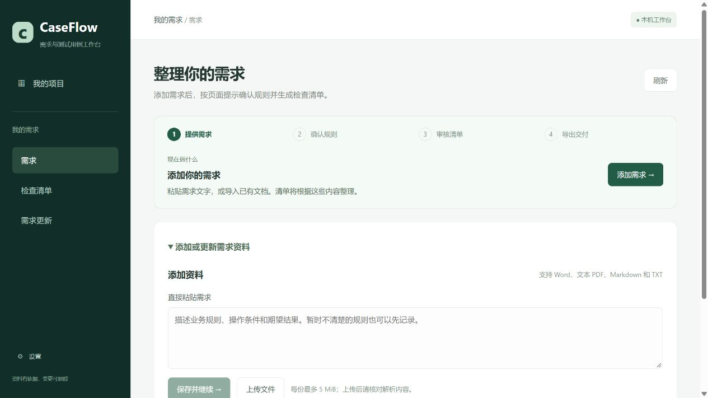
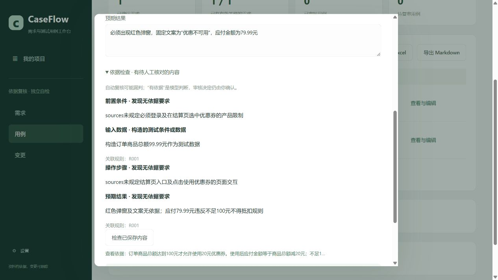

# CaseFlow

**需求与测试用例工作台**

从需求整理到用例交付，让每条测试用例有依据，让需求变化可跟踪。

CaseFlow面向产品、开发和测试人员，将现有需求资料整理成可核对的需求清单，辅助设计供人工执行的检查步骤和预期结果，保存审核、需求变更和实际执行记录。本机部署，支持Word、文本型PDF、Markdown和TXT；当前不生成或运行自动化测试代码。



## 使用流程

1. 新建标准项目，粘贴需求或导入文档，检查解析正文。
2. 填写测试目标，明确选择授权版本，点击“准备依据”。逐段处理后执行检索与原文回读，保存规则草稿、公共条件、问题和覆盖记录。
3. 提取独立测试点，在“测试点评审”中核对意图、规则、条件和精确引用；编辑、人工补充、筛选并记录人工通过或驳回。
4. 明确选择当前已通过的测试点，后台逐点展开详细用例；核对前置、数据、步骤、预期和采用依据，保存人工设计审核。
5. 导出含测试点、规则修订、公共条件及精确原文链接的清单；资料变化后重新准备、复审测试点，显式绑定新修订或应用建议，保留旧执行快照。

第五阶段已接入已批准测试点到详细用例、追溯导出及变更维护。旧项目缺少流程字段时按严格流程读取，保留原有规则确认、直接生成用例、审核、导出和执行记录；新标准项目不能通过旧生成接口绕过测试点评审。切换流程不自动确认规则。

批准测试点不修改规则草稿为已确认，也不代表实际业务测试通过。模型默认关闭；资料保存不会自动调用模型。准备任务沿用现有额度和预算，位置有效、模型意见、人工批准分别展示。

## 功能

| 工作 | 提供的帮助 |
|---|---|
| 需求整理 | 按全文分段提取，保留原文位置；缺失与冲突可登记澄清，遗漏条目可按原文人工补充。 |
| 依据与测试点 | 依据包保存版本、覆盖、检索回读、公共条件和未决问题；稳定TP编号、修订、筛选、人工补充及原子批量评审。 |
| 用例设计 | 已通过测试点逐点展开最多3条草稿，生成与复核采用同一精确依据；严格旧流程保留。 |
| 项目知识 | 原件与不可变文本快照、版本阅读及精确高亮；BM25、向量、混合检索及重排限制在本轮授权资料内。 |
| 审核交付 | 编辑、批量审核、原文追溯、Excel和Markdown导出。 |
| 依据复核 | 分别检查前置条件、输入、步骤、预期，提示未定义的产品要求；已保存用例也可单独检查。 |
| 数值计算 | 人工确认满额抵扣或含上下限的范围规则后，程序计算适用场景的输入和预期，保留计算前草稿。 |
| 变更维护 | 稳定编号、修订历史、候选关联人工确认、修改建议。 |
| 执行记录 | 录入或导入已审核修订的结果，旧结果不自动证明新版通过。 |
| 可靠处理 | 持久任务、幂等请求、租约、保存点及断线查询。 |

## 本机启动

准备Windows、PowerShell 7、Docker Desktop Linux容器、Python 3.12–3.14、Node.js 24和pnpm 11：

```powershell
git clone https://github.com/chen-xinyi111/caseflow.git
cd caseflow
./scripts/local/Setup.ps1
./scripts/local/Start.ps1
```

打开[CaseFlow](http://127.0.0.1:18180/)。在设置中配置服务端密钥环境变量名称和模型服务，再明确启用。模型默认关闭；免费模式要求当前账户的有效免费额度核验，不以密钥存在代表有免费额度。

[操作步骤](docs/DEMO.md) · [使用说明](docs/PRODUCT.md) · [部署配置](docs/DEPLOYMENT.md) · [架构](docs/ARCHITECTURE.md) · [验证范围](docs/VALIDATION.md)

2026-10-25第五阶段实现详细用例、完整追溯与变更闭环。完整流程、实际验证及未验证范围见[第五阶段交接](docs/upgrade/20261025-stage5-cases/00_交接索引.md)。用户业务库未执行升级，启动新版前请先备份并阅读兼容说明。

五阶段实施范围已核查，见[计划完成核查与未验证项](docs/upgrade/20261025-completion-audit/00_完成核查.md)。

## 实现与边界

Vue / TypeScript / FastAPI / LangGraph / PostgreSQL / pgvector / BM25 / Docker。

全文需求提取和RAG分工：提取遍历文档全文，RAG按需寻找规则和参考用例。生成采用有界模型与工具循环，程序检查结构、范围和引用，用户确认业务预期。外部请求先登记，结果未知时不自动重发。

本机单用户应用，不包含扫描件OCR、任意代码执行、自动浏览器测试或企业权限管理。引用存在不代表语义正确，需求关联不等于测试充分，审核通过不等于执行通过。

详见[真实样本检查与局限](docs/EVALUATION.md)。生成每批最多3条；核对发现漏项时，可引用原文补充需求后再确认。


