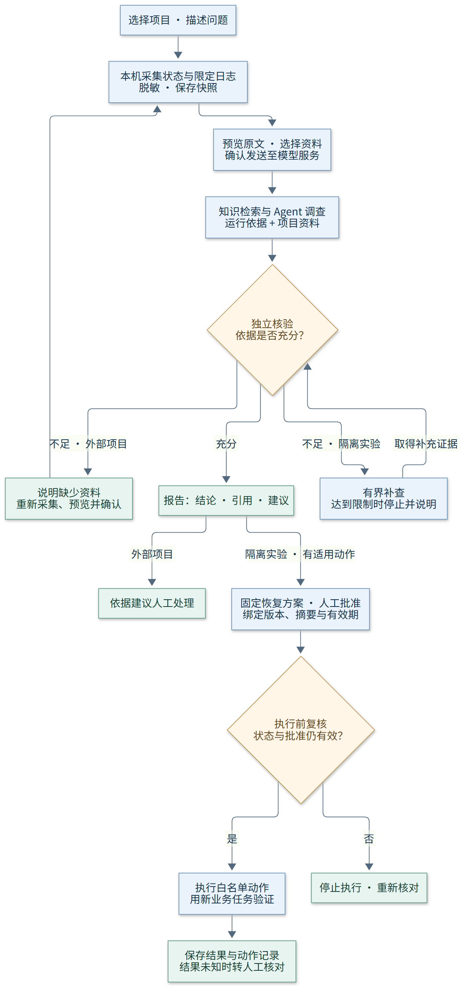
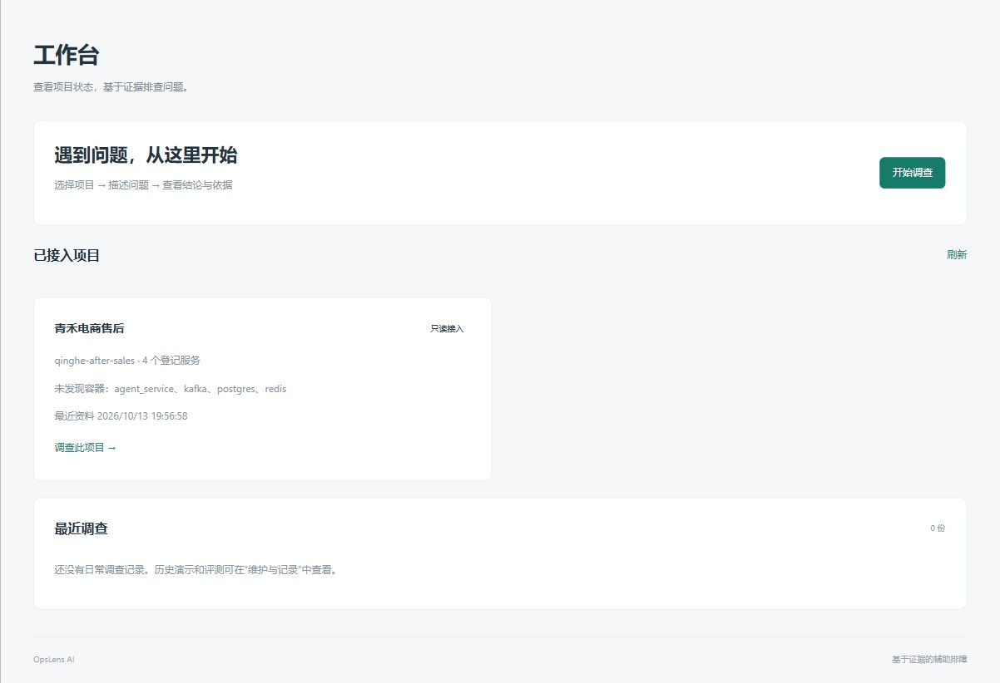
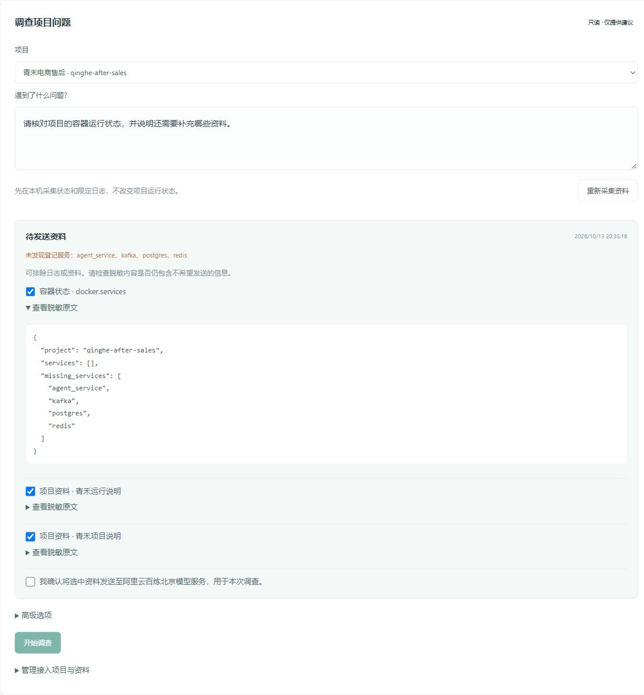
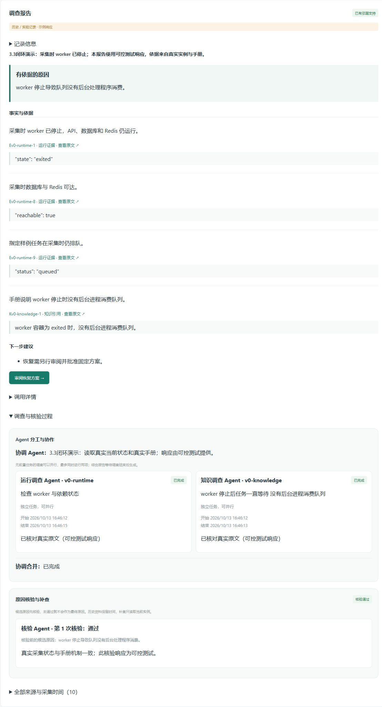
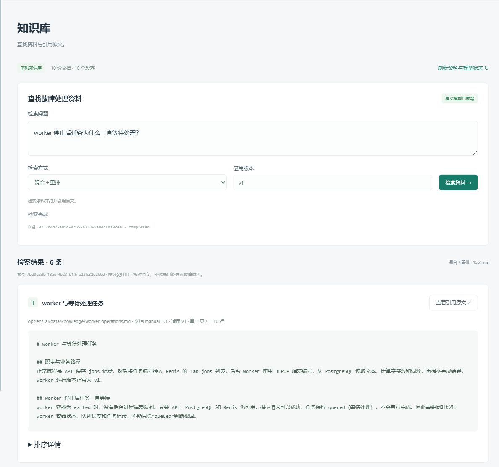
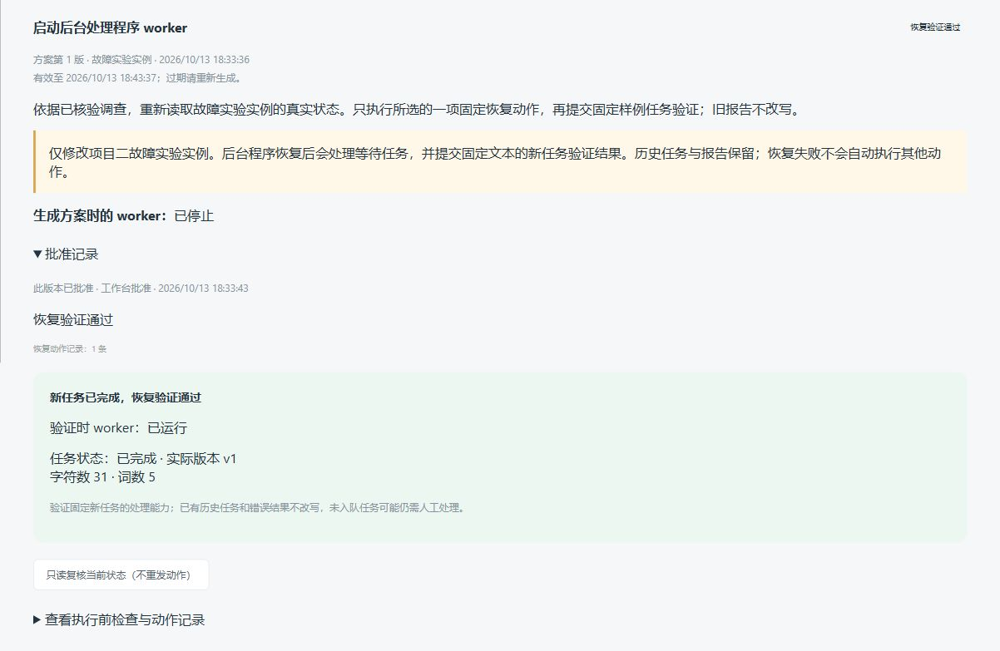
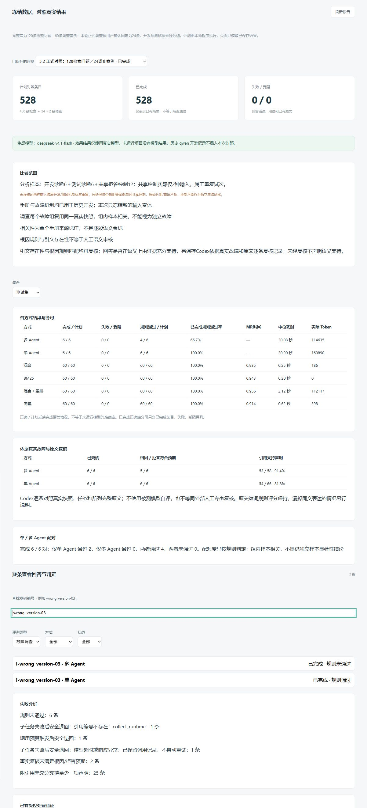

# OpsLens AI

**面向本机 Docker 应用的 AI 辅助运维工作台。** 从项目状态和日志出发，结合项目资料开展只读调查，生成可追溯的结论、引用依据和下一步建议。

OpsLens 将项目接入、证据采集、知识检索、Agent 协作、独立核验和人工审批组织在同一个工作台中。遇到任务积压、服务停止或业务结果异常时，可以先核对资料，再查看调查依据；隔离故障实验还支持批准后的固定恢复动作和业务验证。

## 核心功能

| 模块 | 功能 |
| --- | --- |
| 项目工作台 | 登记本机 Compose 项目和服务范围，查看容器状态、健康检查、最近采集时间与调查记录。 |
| 证据采集与预览 | 限定采集容器状态和近期日志，脱敏后保存固定快照；逐项预览资料，选择需要发送的范围。 |
| 故障调查 | 支持单 Agent、多 Agent 协作及独立核验模式，结合运行证据与知识资料说明异常原因。 |
| 核验与补充信息 | 核对候选结论、引用和证据冲突；信息不足时说明缺少什么。隔离实验支持有界补查，外部项目需重新采集并确认新资料。 |
| 知识库 | 导入文本、Markdown、PDF 资料，保存文档版本和段落来源；支持 BM25、向量、混合检索及重排，并打开引用原文。 |
| 恢复处置 | 在隔离实验中生成固定动作方案，人工批准具体版本后执行前复核，再用新业务任务验证恢复结果。 |
| 持久任务与进度 | 保存任务、步骤、引用、事件和 checkpoint；SSE 展示进度，页面重连后读取已有记录，避免重复执行已保存动作。 |
| 维护与评测 | 查看示例调查、实验环境、测试任务、历史故障和已保存的检索／调查对照，保留失败与事实复核记录。 |

### 一次调查如何开展

1. 在工作台选择项目，描述遇到的问题。
2. 本机采集登记范围内的状态和日志，查看脱敏后的资料。
3. 选择运行证据与项目文档，确认将所选资料及问题发送到模型服务。
4. 查看结论、运行事实、知识依据、缺少的资料和下一步建议。
5. 打开引用原文核对；外部项目依据建议人工处理，隔离实验可以继续审阅恢复方案。

资料变化后需要重新预览与确认。调查结论描述采集时刻的情况；历史报告不会被当作当前运行状态。

## 项目流程



[查看可编辑流程图](figures/opslens-workflow.md) · [Mermaid 源文件](figures/opslens-workflow.mmd)

流程保留两个边界：**外部项目只读调查并提供建议；恢复执行仅限隔离故障实验。** 模型输出不能直接转为任意 Shell 或 SQL 命令。恢复批准绑定方案版本、摘要和有效期，执行前还要检查当前状态；不确定的执行结果转交人工核对。

## 核心页面

以下为实际运行页面的六张核心区域截图。工作台如实展示未发现的容器；调查图使用明确标注的可控演示响应，恢复图查看已有实验记录，评测图来自已保存的真实模型对照。截图展示功能，不表示克隆后已具备这些本机数据。

<details open>
<summary><strong>1. 项目工作台</strong></summary>

查看接入项目、服务状态和最近调查，从统一入口开始排查。



</details>

<details>
<summary><strong>2. 资料采集与发送预览</strong></summary>

逐项核对采集资料和项目说明，选择发送范围，在启动 AI 调查前明确确认。



</details>

<details>
<summary><strong>3. 调查报告与独立核验</strong></summary>

查看结论、可打开的证据引用和核验过程；可控示例保留来源标识。



</details>

<details>
<summary><strong>4. 知识库与引用原文</strong></summary>

选择检索方式，查看候选资料的来源、版本及段落，打开原文核对依据。



</details>

<details>
<summary><strong>5. 恢复方案与业务验证</strong></summary>

审阅版本绑定的恢复方案，并查看已有动作记录和新业务任务的验证结果。



</details>

<details>
<summary><strong>6. 对照评测与失败分析</strong></summary>

读取已保存的检索与调查对照，区分完成覆盖、规则评分和事实复核，保留比较范围与失败信息。



</details>

## 技术实现

| 层次 | 技术与职责 |
| --- | --- |
| 前端工作台 | Vue 3、TypeScript、Vite：项目状态、调查表单、引用原文、审批与评测页面。 |
| 服务接口 | FastAPI、Pydantic：请求校验、接口边界、本机访问限制和任务查询。 |
| Agent 编排 | LangGraph：调查规划、运行／知识角色分工、候选结论、独立核验与实验补查。 |
| 知识检索 | BM25、pgvector、RRF、重排：组织召回和排序，保留文档版本、段落与原文。 |
| 模型服务 | 百炼北京地域兼容接口：生成、向量和重排；逐模型核验额度，缺失或失效时停止调用。 |
| 数据与任务 | PostgreSQL：证据快照、任务租约、checkpoint、SSE 事件、调查报告、审批和执行记录。 |
| 隔离实验 | Docker Compose、PostgreSQL、Redis：独立正常／故障实例与固定业务探针。 |
| 本机运行 | PowerShell：依赖安装、配置生成、构建、启停、预检及私有备份。 |

外部项目资料在本机按项目范围进行 BM25 检索；实验知识库支持向量、混合检索和重排。任务处理使用持久队列与租约，已有动作不重复发出；模型调用结果未知时保留记录，停止自动重试。

## 快速开始

### 环境要求

- Windows 与 PowerShell 7。
- 已启动的 Docker Desktop，使用 Linux 容器。
- Python 3.12–3.14、Node.js 24、pnpm 11。
- 建议 Docker 至少分配 4 GiB 内存；启动预检要求 Docker 内存和本机可用内存各至少 2 GiB、项目磁盘空闲至少 4 GiB。

### 安装与启动

在 PowerShell 7 中执行：

```powershell
git clone https://github.com/chen-xinyi111/opslens-ai.git
cd opslens-ai
./scripts/local/Setup.ps1
./scripts/local/Start.ps1
```

安装脚本使用锁定依赖并生成本机随机配置，首次安装需要网络。默认启动平台与平台数据库，打开 [OpsLens 工作台](http://127.0.0.1:18180/)。已有配置和数据卷保留。

没有模型密钥时，仍可查看本机状态、采集资料和使用关键词检索。真实 AI 调查另需本机 `DASHSCOPE_APIKEY`、有效的逐模型额度核验记录及资料发送确认；语义检索另需构建索引。项目不附带密钥、免费额度、数据库或本机历史结果，完整步骤见 [部署与排错](docs/DEPLOYMENT.md)。

### 常用操作

```powershell
./scripts/local/Status.ps1                 # 查看本机状态
./scripts/local/Check.ps1                  # 启动条件预检
./scripts/local/Stop.ps1                   # 停止平台，保留数据卷
./scripts/local/Start.ps1 -Scope Fault     # 显式启动隔离故障实验
./scripts/local/Backup.ps1 -VerifyRestore # 私有备份及独立还原验证
```

需要体验恢复流程时，先阅读 [隔离实验演示](docs/DEMO.md)。日常启动不会自动启动接入项目，也不会准备故障或批准恢复。

## 目录结构

```text
frontend/                Vue 工作台与前端检查
src/opslens/             接口、证据采集、检索、调查、核验与恢复
src/lab/                 隔离实验业务与故障辅助组件
data/knowledge/          内置运行手册与检索定义
data/external/           接入项目的文本资料
data/evaluation/         冻结评测定义与原实现快照
compose/                 平台及实验环境配置
scripts/                 本机运行、评测、导出与检查脚本
tests/                   后端自动检查
docs/                    使用、部署、架构、备份与页面截图
figures/                 项目流程图与可编辑源文件
```

## 使用边界与开发检查

当前面向单人本机使用，不提供公网、多租户、远程 Docker 或外部项目自动恢复。外部日志限定每个来源最近 80 行、脱敏后最多 64 KiB；不读取容器环境变量、挂载文件或外部业务数据库，不执行容器命令。

评测页面展示本机保存的对照结果。冻结定义与历史实现保留原始摘要，旧 manifest 中的源码提交属于原开发历史，不对应公开仓库的新提交。重复控制试次和共享快照造成样本相关，不据此声称独立故障上的统计显著性或生产能力。

```powershell
./.venv/Scripts/python.exe -m pytest --ignore=tests/test_integration.py --basetemp=.runtime/pytest-local
./.venv/Scripts/python.exe scripts/check_publication.py
cd frontend
pnpm test
pnpm run build
```

数据库检查使用独立测试 schema，并需要本机平台数据库配置；集成检查另需实验实例。可控测试响应与真实模型效果分别记录。提交前检查文件和图片，`.env`、运行数据、备份和密钥均保留在 Git 忽略范围内。

[使用说明](docs/PRODUCT.md) · [部署与排错](docs/DEPLOYMENT.md) · [架构说明](docs/ARCHITECTURE.md) · [私有备份与还原](docs/ARCHIVE.md)
