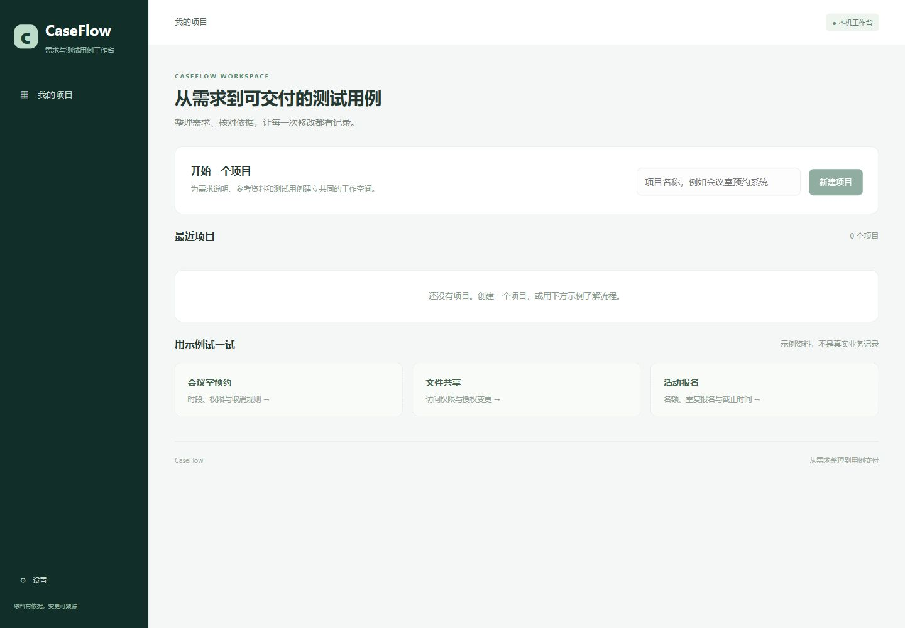

# CaseFlow

**需求与测试用例工作台**

从需求整理到用例交付，让每条测试用例有依据，让需求变化可跟踪。

CaseFlow面向产品、开发和测试人员，将现有需求资料整理成可核对的需求清单，辅助设计用例，保存人工审核、需求变更和实际执行记录。本机部署，支持Word、文本型PDF、Markdown和TXT。



## 使用流程

1. 新建项目，粘贴需求或导入文档，检查解析正文。
2. 选择允许处理的资料，整理需求、澄清缺失规则并确认清单。
3. 选择确认需求，生成用例，核对前置条件、步骤、预期与来源。
4. 编辑并审核用例，导出Excel或Markdown。
5. 更新需求，逐项确认变更，保留原用例和人工修改。
6. 记录实际执行结果，或使用Excel／CSV模板导入，按用例修订查看历史。

页面内置会议室预约、文件共享和活动报名示例。示例不是生产记录，生成用例也不代表测试已经执行。

## 功能

| 工作 | 提供的帮助 |
|---|---|
| 需求整理 | 按全文分段提取，保留原文位置；缺失与冲突进入澄清流程。 |
| 用例设计 | Agent读取确认需求、查找资料和已有用例，提交待审核草稿。 |
| 项目知识 | BM25、向量、混合检索及重排，限制在本轮授权资料内。 |
| 审核交付 | 编辑、批量审核、原文追溯、Excel和Markdown导出。 |
| 变更维护 | 稳定编号、修订历史、候选关联人工确认、修改建议。 |
| 执行记录 | 录入或导入已审核修订的结果，旧结果不自动证明新版通过。 |
| 可靠处理 | 持久任务、幂等请求、租约、保存点及断线查询。 |

## 本机启动

准备Windows、PowerShell 7、Docker Desktop Linux容器、Python 3.12–3.14、Node.js 24和pnpm 11：

```powershell
git clone https://github.com/chen-xinyi111/opslens-ai.git
cd opslens-ai
./scripts/local/Setup.ps1
./scripts/local/Start.ps1
```

打开[CaseFlow](http://127.0.0.1:18180/)。在设置中配置服务端密钥环境变量名称和模型服务，再明确启用。模型默认关闭；免费模式要求当前账户的有效免费额度核验，不以密钥存在代表有免费额度。

[示例资料](data/caseflow-examples) · [演示步骤](docs/DEMO.md) · [使用说明](docs/PRODUCT.md) · [部署配置](docs/DEPLOYMENT.md) · [架构](docs/ARCHITECTURE.md) · [验证范围](docs/VALIDATION.md)

## 实现与边界

Vue / TypeScript / FastAPI / LangGraph / PostgreSQL / pgvector / BM25 / Docker。

全文需求提取和RAG分工：提取遍历文档全文，RAG按需寻找规则和参考用例。生成采用有界模型与工具循环，程序检查结构、范围和引用，用户确认业务预期。外部请求先登记，结果未知时不自动重发。

本机单用户应用，不包含扫描件OCR、任意代码执行、自动浏览器测试或企业权限管理。引用存在不代表语义正确，需求关联不等于测试充分，审核通过不等于执行通过。
