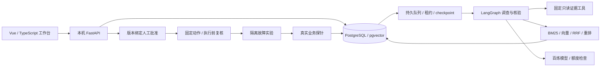

# 架构与功能边界

前端通过本机 FastAPI 操作平台数据库中的项目、证据、调查与审批记录。任务由持久队列处理，LangGraph 组织调查分工、候选结论及独立核验，SSE 提供可重连的进度事件。

## 组件与数据流

用户视角的流程见 [项目流程图](../figures/opslens-workflow.md)。

## 外部项目只读调查

登记 Compose 项目名和允许采集的服务 → 本机采集状态与限定日志 → 保存快照和项目资料版本 → 预览与选择 → 摘要绑定发送确认 → 调查与核验 → 引用原文及人工建议。

Docker 工具仅查询精确项目标签、允许的状态／镜像字段和限定日志，不执行容器命令，不读取环境变量、挂载或业务数据库。所选项目的文本资料在本机用 BM25 检索；不会借用其他项目手册证明当前业务状态。

外部核验问题无法由确认快照解决时，说明缺少的信息，并要求重新采集和确认，不重复读取旧快照冒充新证据。外部项目在前端和后端均被禁止执行恢复动作。

## 调查、知识与核验

支持单 Agent、多 Agent 分工和独立核验。调查保存运行事实和知识依据的来源、文档版本、段落及原文。候选结论与独立核验分开；引用存在性检查不能替代语义支持判断，资料不足时保留停止原因。

实验调查最多六个子任务、两个并行任务、八次生成、十二次工具调用、两次重新规划和 240 秒活动处理时间。知识检索按版本组织文档，采用 BM25、向量召回、RRF 融合及可选重排，最终最多六条引用。

## 审批、恢复与任务持久化

自动恢复仅作用于独立故障实验的固定动作白名单。人工批准绑定方案版本、摘要和十分钟有效期，执行前重新读取状态，完成后通过新业务任务核验效果。

租约续约、执行批次和事务保存防止旧线程迟到写入；步骤、引用、checkpoint 和事件支持进程中断后的继续处理。已有动作不重发，固定编号查回业务探针；不能确认结果时转人工。SSE 游标支持重连，请求编号支持幂等。

## 模型与评测

模型密钥只在本机读取。免费额度核验绑定模型、端点和密钥指纹，24 小时后失效；缺失时阻断调用，不自动切换为付费请求。结果未知的模型请求不自动重试。

评测定义及原始实现快照保持冻结摘要；本机保存的真实结果、规则评分和事实复核分别展示。公开仓库不携带模型原始响应、数据库或账户核验记录，不承诺独立样本上的显著性或生产环境诊断准确率。

平台、正常实验、故障实验使用独立 Compose 项目、网络和数据卷。当前仅支持本机单用户，不提供公网、多租户、远程 Docker、集群调度或外部自动恢复。
