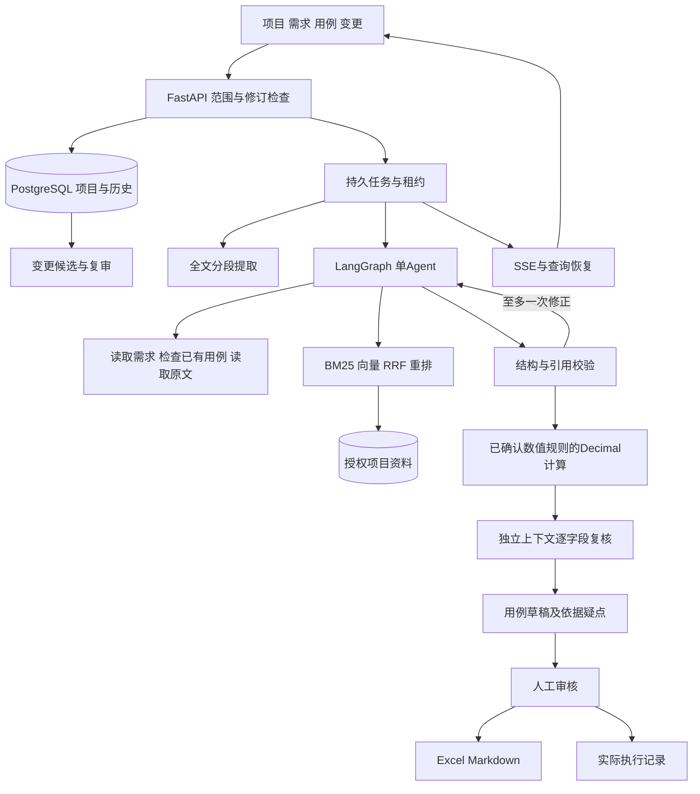

# CaseFlow 架构

opslens.caseflow承担新业务，复用已有模型、检索和持久化基础。项目级JSONB聚合记录资料、需求、用例、变更和不可变修订快照；独立表记录任务、事件、审计和外部请求。项目行锁及乐观修订阻止迟到生成覆盖人工内容。澄清记录显式关联需求，开放问题阻止确认；决策回答保留来源，仍须人工重新确认需求。

需求提取按全文分段；用例设计采用design→tools→design循环，最终validate提交每批最多3条草稿。工具为read_requirements、existing_cases、search_documents、read_document。每轮最多5次设计调用、8次工具调用，再预留1次依据复核，合计最多6次模型调用，完整上下文限制32KiB。全文提取任务按段登记并保留进度。

草稿格式、引用或范围校验失败时，把错误及本轮确认需求中已核验的原文引用反馈给模型，至多修正一次；该次仍计入6次生成上限。不替模型静默改写引用，不降低范围和连续原文校验要求；整批通过前不保存任何用例。修正失败则明确停止，外部响应未知也不会通过该流程重发。

grounding.py在新上下文中复核四个字段，仍使用已配置的同一模型，不是另一个自主Agent。输入只含关联的已确认需求、授权引用、用户回答及程序计算记录。输出必须覆盖全部用例与四个字段，支持依据不能引用其他用例的规则；测试数据可出现在输入和描述构造对象的前置条件，不能用该分类掩盖业务预期。复核是可错的语义判断，不是形式化证明。模型不可用或复核格式无效时，只保留已通过结构和原文校验的草稿，标明未复核，不显示通过。

数值规则由用户显式确认并绑定需求修订；数值必须出现在已确认需求或回答中，不从检索结果自行认定。仅支持满额固定抵扣及闭区间范围，用Decimal执行固定算式，没有动态代码执行。关联需求完整匹配规则时，生成必须提交结构化numeric_input；程序生成规范输入及预期，保留原草稿，不据此推导其他条件或整体交易成功。规则变更及需求修订会让相关检查失效。

依据报告绑定内容及相关规则指纹。已有用例可通过review持久任务复核，保存报告但不改写人工内容；出现新疑点时已审核用例转待复审。编辑字段后原报告失效，原数值计算标记移除；再次审核需重新检查或明确逐项人工确认并记录说明。Excel及Markdown附带依据检查状态，审核和执行状态独立保留。

索引成员显式绑定本轮授权文档，始终指定索引，不使用全局活动索引。生成支持百炼免费配置与兼容接口；语义检索和重排使用已核验百炼配置。检索无结果不能证明整篇没有某项需求。

Runtime通过租约续约、执行批次和保存点控制任务。外部请求先标记issued，结果已保存则复用，未知则停止。SSE按编号补读，数据库查询决定最终状态。任务输入绑定模型配置与处理规则签名，签名包含提示、分段、检索参数及Embedding／重排模型标识；续跑和最终提交均核对范围，防止沿用失效上下文。

修改建议由服务端记录原用例修订，应用前检查该修订和需求确认状态。复审采用新的需求修订时，即使用例文字未改，也会产生新用例修订。执行记录始终绑定实际的用例快照；旧结果不能转算为新修订通过。页面同步未编辑字段，保留人工输入并提示服务器内容冲突。

当前适合本机单用户；大规模协作需进一步拆分实体表、增加权限与并发设计，不作企业规模承诺。结构及引文检查不能替代业务语义审核。

## 第三阶段：文档版本与位置证据

新增documents/documents_api模块。cf_document_versions追加保存原件bytea及SHA256、规范pages/units快照及摘要、格式和解析签名；现有document_id作为不可变版本身份，previous_id继续形成版本链。cf_evidence绑定项目、版本、快照摘要和有序区间，独立外键及禁止更新/删除触发器保护侧表。业务JSON仍保留旧pages、R/T编号、修订和历史；导入在同一事务中写入原件侧表与业务状态。

区间从0开始、结束不包含，单位为Unicode code point。PDF单元使用真实页号，DOCX保留表格段落标记，MD/TXT为段落，旧未知格式统一legacy_text。GET不填充旧侧表；显式迁移或建立精确证据时才追加旧文本快照，不重新解析。精确证据只证明位置一致；旧page/quote继续保留，重复匹配不自动选择第一处。

前端KnowledgeLibrary与DocumentReader通过项目级接口阅读；hash路由绑定项目/文档/证据，刷新由根页面恢复。规范文本用Vue文本节点和mark高亮，PDF原件使用浏览器iframe；不实现PDF像素坐标覆盖。索引投影从冻结快照逐页切块，保留page/start/end；不会把展平TXT的位置猜回PDF。投影TXT只属于内部KB，不作用户原件。索引身份包含版本、参数和检索模式，始终使用显式成员及映射；上传、阅读、定位和迁移均不调用模型。

数据库约束、迁移与含bytea备份恢复仍待真实PostgreSQL验收；本轮证据见[第三阶段记录](upgrade/20261024-stage3-sources/02_验证记录.md)。
