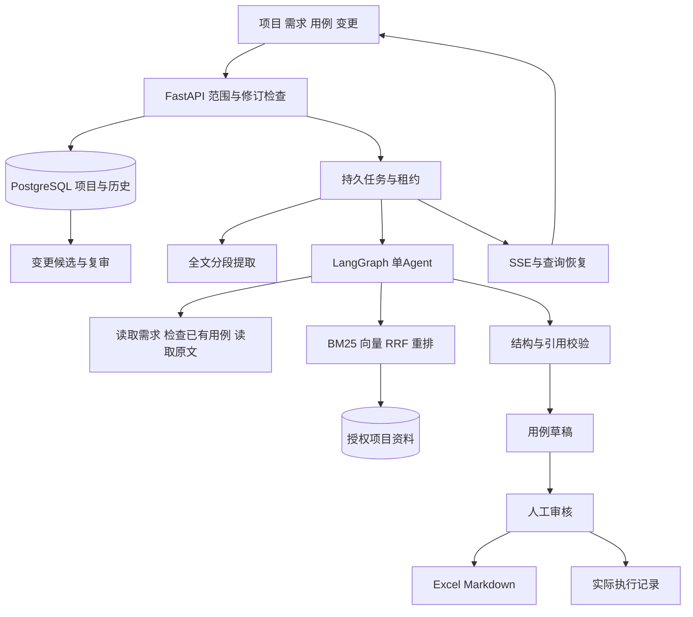

# CaseFlow 架构

opslens.caseflow承担新业务，复用已有模型、检索和持久化基础。项目级JSONB聚合记录资料、需求、用例、变更和不可变修订快照；独立表记录任务、事件、审计和外部请求。项目行锁及乐观修订阻止迟到生成覆盖人工内容。

需求提取按全文分段；用例设计采用design→tools→design循环，最终validate提交草稿。工具为read_requirements、existing_cases、search_documents、read_document。每轮最多6次生成、8次工具调用，完整上下文限制32KiB。全文提取任务按段登记并保留进度。

索引成员显式绑定本轮授权文档，始终指定索引，不使用全局活动索引。生成支持百炼免费配置与兼容接口；语义检索和重排使用已核验百炼配置。检索无结果不能证明整篇没有某项需求。

Runtime通过租约续约、执行批次和保存点控制任务。外部请求先标记issued，结果已保存则复用，未知则停止。SSE按编号补读，数据库查询决定最终状态。

当前适合本机单用户；大规模协作需进一步拆分实体表、增加权限与并发设计，不作企业规模承诺。结构及引文检查不能替代业务语义审核。
