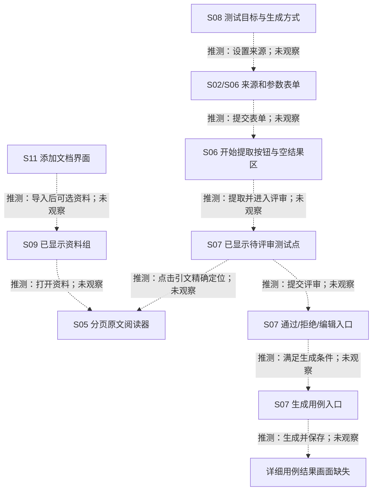

# 参考状态清单与转换草图

日期：2026-10-24。本文件只分析截图；未运行参考站。图片编号与完整文件名见[逐图索引](参考页面分析.md)。

## 截图中可见的状态

| 对象 | 【截图已见】 | 来源 | 不能推出的结论 |
|---|---|---|---|
| 知识库 | `reqs`、就绪、最近更新／索引时间、更新历史一条绿色图标记录 | S11 `fe50da8ef54903fea3aabbff0127dbc1.jpg` | 不证明本轮上传、所有文件已解析、索引一致或原件持久化 |
| 资料组 | 资料组 1、资料库 2、默认工作区下的需求文档卡 | S09 `d87c6cd48608f4c2ebefa1ba708740cb.jpg` | 不证明工作区隔离机制或与知识库自动同步 |
| 阅读器 | 第 10 页／共 33 页，目录、原文、未显示回答的提问框 | S05 `4b16a6677509cbd63b9fc0ea24daef50.jpg` | 不证明由引用跳转而来或高亮定位成功 |
| 设计方式 | 先提取测试点供我评审的选中边框；另有直接生成用例 | S08 `d316ccd35a0b78ef51f4d7bed95e9e1e.jpg` | 不证明模式已保存或“直接生成”真的自动通过测试点 |
| 来源选择 | S02 为 1 个知识库；S06 为知识库与 Wiki 各 1 个 | S02 `22e4f7c2d249ba7ff5f915423a5040f5.jpg`；S06 `566d299321871ec86c8868649dfef744.jpg` | 不证明同一次会话中已执行 1→2 的转换 |
| 提取结果区 | 空态与调研、场景建模、提取测试点文字 | S02/S06/S08 | 不证明已经运行三个顺序阶段、使用何种进度协议 |
| 测试点会话 | 共 20、待审 20、需关注 1、已审 0/20 | S07 `cf7523a953551031089d09f4211f3c25.jpg` | 没有已通过、已拒绝实例；需关注不一定是互斥状态 |
| 单测试点 | 引用已校验和待评审同时出现，卡片可展开／折叠 | S07 | 引用标签不是人工批准，更不是业务执行通过 |
| 批量候选 | 通过已校验待审(19)、通过专家建议通过的(0)、生成用例(0) | S07 | 不证明分组统计规则、选择范围、批准前置条件 |
| 任务 | 另一目标的需求分析“进行中”，0 用例／0 测试点，1 个任务进行中 | S07 | 不证明当前管理员会话仍在生成；不证明可恢复或不重复 |
| 工作台 | 用例 3、待审点 20、运行任务 0，近期任务绿色／红色图标 | S03 `348f18257db9fceb4e18b98d952e8f31.jpg` | 不证明图标语义、任务因果、统计作用域；不与 S07 强行合并 |

没有将红色图标正式编码成 `failed`，也没有将“就绪”编码成后端枚举。本轮不定义参考站内部状态机。

## 参考交互假设：所有连线均待验证

下图节点标签引用直接看到的界面。**所有虚线箭头都是操作假设，不是已观察的转换**。没有已验证的实线箭头；S05 阅读器与 S07 引用来自不同画面，尤其不能视为已完成跳转。

独立源文件：[状态草图.mmd](状态草图.mmd)。图只表达需观察的连线，不表示固定执行顺序或自动路由。

## 逐条待观察的转换

| 编号 | 操作假设【推测／待验证】 | 需要看到什么才可补充“运行已观察” |
|---|---|---|
| T01 | 文件选择 → 上传／解析／索引 → 就绪 | 同一资料的操作、任务和结果，失败实例；刷新后的文件与状态 |
| T02 | 资料组列表 → 阅读器 | 实际打开对象、文档标识、页码变化、返回路径 |
| T03 | 目标／来源／参数 → 提取任务 | 提交校验、真实请求、任务标识及结果的输入关联 |
| T04 | 提取进行中 → 完成／失败／部分结果 | 连续事件与最终查询；不凭空态阶段文字认定流式实现 |
| T05 | 待评审 → 通过／拒绝 | 单项操作前后正文和状态、服务响应、刷新后的保存结果 |
| T06 | 选择测试点 → 批量评审 | 选择范围、资格检查、部分失败、计数和刷新结果 |
| T07 | 测试点编辑／依据变化 → 新状态 | 编辑弹窗与保存结果、修订／审核历史，依据更新后的变化 |
| T08 | 点击引文 → 同版本原文命中 | 位置、引文匹配、重复文字消歧、复制 URL、刷新和旧版本行为 |
| T09 | 选定测试点 → 详细用例 | 是否要求批准，输入的测试点修订、生成结果和保存关系 |
| T10 | 任务断线／恢复 → 已有或部分结果 | 同一任务恢复、是否产生重复调用或重复数据、未知响应的处理 |

“通过／拒绝”仅在按钮文案中出现；“已通过／已拒绝”的实际状态、可逆性和权限未观察。删除、清空全部与直接生成的行为同样不能从入口推定。

## 留给第二阶段的 CaseFlow 设计边界

以下来自已确认的五阶段计划，属于【拟实现设计】，不是参考状态实测：

- 将引用位置校验、模型依据复核、人工评审分别保存和展示，不能合成一个绿色“正确”状态。
- 测试点拟采用待评审 → 通过／驳回；内容或依据变化后待复审。具体状态字段、并发校验和迁移方案由第二阶段源码设计确定。
- 需关注、未解决冲突和依据有效性应能影响相关测试点的可批准性；不阻塞独立内容。批量通过不得绕过检查。
- 用例生成完成后仍是草稿，人工设计审核与真实业务执行结果继续分开。
- 原文版本、测试点修订、用例修订与历史执行需要形成可追溯关系；截图未证明参考产品如何实现。

本阶段只确定上述证据边界，没有更改 CaseFlow 状态或 API。
