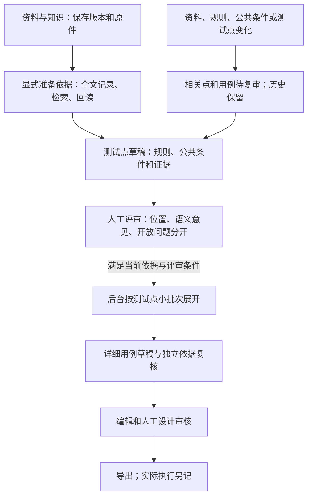

# 页面与流程设计（拟实现）

日期：2026-10-24。以下是 CaseFlow 待开发方案，不是参考站实测。当前行为依据[源码证据 C01—C21](01_源码证据与差距清单.md)，参考画面依据第一阶段 S01—S11。

## 导航和页面职责

保留当前 Vue/TypeScript 和 CaseFlow 主入口，按业务拆出子组件，不加载旧 OpsLens 全套工作台。项目内提供四个入口：**资料与知识、测试点评审、用例、需求更新**。任务中心始终可见，设置沿用原入口。

| 页面 | 主要输入与操作 | 展示与输出 |
|---|---|---|
| 资料与知识 | 粘贴／上传、选择用途与更新的旧版；查看／下载原件；选择资料范围；填写测试目标；准备依据 | 当前／历史资料、真实格式、来源网址、解析提醒、原件是否存在、版本、索引状态、全文处理覆盖、准备结果与待澄清问题 |
| 测试点评审 | 从准备结果提取、手工补点、编辑、分组筛选、逐项／批量评审、选择点生成用例 | TP 编号／修订、测试意图、场景组、类型、模块、标签、优先级、规则与公共条件、精确引文、三类检查状态、复审原因 |
| 用例 | 选择多个已通过点展开；编辑／审核草稿；查看关联与历史；导出；保留已有执行录入／导入 | T 编号／修订、TP 与 R 关系、证据版本、生成组进度、草稿／审核／执行的独立状态、旧用例直接关联说明 |
| 需求更新 | 对照候选并决定新增／替换／移除／保留；处理相关问题；复审测试点；接受用例修改建议 | 原件版本对照、受影响的规则／点／用例、人工内容保护、旧修订、旧执行结果；不自动应用模型建议 |

“资料与知识”内保留可折叠的规则清单、澄清和数值规则，严格流程仍可操作；不另建一套重复的需求规则页面。场景只作为测试点分组，不新增独立场景审核资源。

## 页面草图

### 资料与知识

```text
项目名     标准流程 / 严格流程                         [任务中心]
资料与知识 | 测试点评审 | 用例 | 需求更新

[添加资料 / 更新已有资料]   [显示历史版本]
名称 / 用途 / 格式 / 版本 / 原件 / 解析提醒 / 索引状态 [阅读]
[√]需求V2 [√]公共条件V1                  来源网址（可选）

测试目标 [围绕……检查什么                                      ]
[允许处理所选资料] [准备依据]  段数/批次提示，沿用现有预算

准备结果：目标规则 | 适用公共条件 | 原文片段 | 待澄清 | 处理范围
每份资料：读取段数、跳过/空白提醒、检索记录、未完成项
[查看规则细节] [提取测试点]
```

上传与粘贴只保存资料，不隐式调用模型或建立语义索引。准备依据是显式模型任务；提交前展示选中版本、预期分段数和请求次数只作估算，费用／额度沿用现有设置，不自动换模型或增预算。

准备结果有“就本次已选范围完成处理”的含义，不能写“全部业务知识已找全”。已遍历但没有目标相关规则时明确显示无可用目标规则；不能用常识补出需求。失败／未读段保留在任务中，允许缩小范围形成新的准备结果，不悄悄忽略失败文档。

### 测试点评审

```text
测试目标 / 准备结果版本  已审 x/y   待复审 z   需关注 n
[搜索] [类型] [模块] [优先级] [状态] [仅需关注]
场景组列表     [选中可评审项] [通过] [驳回] [手工补充] [生成用例]

[√] TP001 · 修订1 · 检查时长上限     P2 / 边界 / 预约
测试意图：在其他条件满足时，单独检查时长边界
目标规则 R001@2；公共条件 B项；原文证据 [版本2 · 页3 / 段落5]
引用位置：有效    模型意见：待人工核对    人工评审：待评审
疑问／复审原因：……              [编辑] [阅读依据] [通过] [驳回]
```

类型统一为正常、异常、边界、权限、状态、界面、接口、性能、安全，可多选；默认正常。模块默认“未分组”，标签为空；优先级 P1/P2/P3、默认 P2。这些是新功能默认值，不迁改旧数据。没有证据的 UI、接口或性能要求可保存为待澄清草稿，不能批准为已证实要求。

批量评审只提交明确选择的 ID 与修订；“通过可评审项”先展示符合条件的集合和跳过原因，不等同“通过全部待审”。服务器仍重新检查所有前提。批量请求任一条已过期或非法时整批不写入，返回逐条原因，用户重新选择有效集合，不暗中部分批准。

### 原文阅读面板

- 上方显示资料名、版本、来源、原件可用性、规范文本／脱敏提醒、解析器版本；提供复制定位链接、查看其他版本和下载原件。
- PDF：按真实物理页导航，原 PDF 同页预览与规范文本并排；**逐字高亮保证落在冻结的提取文本中**，不承诺 PDF 图像版式上的精确矩形高亮。PDF 预览可用本机浏览器内置阅读器，文本定位不依赖其锚点行为；预览不可用时仍可阅读高亮文本并下载原件。
- DOCX：以段落／表格内文本块阅读，不伪造 Word 页码；MD/TXT／粘贴资料按段落和字符区间，不把内部 page=1 展示为“第1物理页”。
- 跨页引用以多个连续片段逐项高亮，不把中间未引用文字合成一条连续原文。重复文字依靠已保存位置区分，不能取第一个匹配。
- 旧资料缺原件时展示原有提取文本，明确“历史文本，原文件未保存”；未知格式使用“历史文本段”，不凭扩展名推定物理页。没有证据坐标时打开候选段并提示人工选取，不显示已精确定位。
- 新证据链接进入确定的历史版本，即使已有新版，也只提示“存在更新版本”，不自动跳到最新版。归档项目可只读打开，归档不破坏旧链接。

采用 hash 路由，避免当前后端只服务 `/` 导致深路径刷新 404：`/#/projects/{pid}/documents/{document_id}?evidence={evidence_id}`。项目页使用 `/#/projects/{pid}/{knowledge|points|cases|changes}`，选中点／用例可加 ID。启动先解析显式 URL，再使用旧 localStorage 项目偏好；非法 ID 明确报错，不落回其他项目。

## 标准与严格流程

**新项目在第 4 段上线后默认 standard，旧项目缺失字段按 strict 读取**。第 3 段尚无测试点功能时仍使用现有流程。用户可显式切换，切换只改变后续准入与界面，不代填规则确认、测试点批准或模型检查记录；需递增项目修订、审计并使未完成任务过期。

- 标准：选择目标与资料 → 准备依据（必要时全文整理）→ 测试点草稿 → 人工评审 → 详细用例草稿 → 人工设计审核。普通 R 草稿可以作为分析依据；它们仍是 draft，人工批准的是具体 TP 对当前规则及证据的使用，不伪装成逐条确认过 R。
- 严格：保留规则确认，进入新的点链路时要求点依赖的目标规则和规则类公共条件全部 confirmed；旧版直接按确认 R 生成的 API 和历史资产仍可使用，界面收在“历史严格流程”入口。
- 共同门槛：未解决的关联冲突／问题、无有效依据、过期准备结果或已改变的点不能批准；数值计算始终只用显式确认且关联规则 confirmed 的数值规则。

相关冲突只影响依赖它的测试点。完整遍历的准备包可以带着未解决问题完成，点卡片分别显示阻塞原因；不能因项目存在一个无关问题就禁用全部点。若资料尚未读完，先完成任务或主动缩小资料范围形成新包，不宣称未读部分无影响。

## 三类状态与人工责任

1. 位置校验由程序执行，表示版本、区间、文字与哈希一致。
2. 模型依据复核是可错的语义意见，保存 checked／needs_confirmation／unavailable 及指纹，不批准内容。
3. 人工评审保存 approved／rejected 及理由。自动检查未完成时，用户可逐项阅读当前依据并留下结构化人工核对记录；不能用一个全局勾选绕过开放问题、失效依据或数值确认。

模型误判可由人工在当前证据上记录解释并解决；缺失业务规则必须先补充有来源的规则或已确认回答，不能只填写“我确认”让无依据要求变为有依据。用例“已审核”与实际“通过／失败／阻塞／未执行”始终分别展示。

## 主流程图（全部为拟实现）



源文件：[主流程.mmd](主流程.mmd)。流程图是设计，不将第一阶段的推测连线改写为实测。

## 界面验收重点

桌面与 390px 窄屏均需实际检查：资料→准备→点评审→用例→更新；引用复制、刷新、跨项目错误、历史版本与重复原文；批量资格与任务部分完成；人工未保存内容不被后台刷新覆盖。按钮禁用必须有具体原因，任务失败与未知响应直接可见。具体编号见[分阶段验收](05_兼容迁移与分阶段验收.md)。
