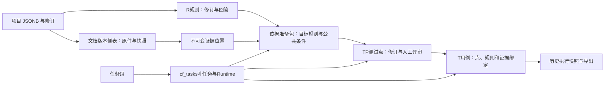

# 数据、证据与版本设计（拟实现）

日期：2026-10-24。复用 PostgreSQL、项目 JSONB、RAG、cf_tasks 和 Runtime。不引入新数据库、对象存储、跨项目共享或另一套模型配置。

## 资源职责与身份

| 资源 | 负责什么 | 版本／身份决定 |
|---|---|---|
| 文档版本 | 用户原件、规范解析快照及来源元数据 | 保留现有 document_id；每次更新新 ID，previous_id 指向旧版；逻辑资料根由链首推导，不重编号 |
| 证据位置 | 某个不可变版本内可复核的精确文字位置 | 新 evidence_id；位置与文字校验后由程序创建；不由模型自由拼 URL |
| 需求规则 | 可测试的业务要求、回答、原文关系 | 复用现有 R 编号与 revision；草稿／确认／排除继续保留 |
| 依据准备包 | 一个目标与授权版本下的目标规则、公共条件、上下文和处理记录 | 新 basis bundle，ID 与版本内容不可变；修改选择或目标创建新包，旧包可查 |
| 测试点 | 要检查什么、为何检查及采用哪些依据 | 新 TP001 编号、revision；场景只是 group 字段；独立人工评审 |
| 详细用例 | 测试者可操作的前提、数据、步骤、预期 | 复用 T 编号与 revision；保存 TP/R/公共条件/文档版本关系 |
| 任务组 | 多个小批次的进度、续做和提交结果 | 独立记录，避免进度更新污染项目业务修订 |

## 新增侧表与现有状态扩展

原始文件不塞入 `cf_projects.state`，也不复用 CaseFlow 当前拼接 TXT 的 original_bytes 充当原件。新增 3 张表；这里描述接口和约束，第三阶段才编写迁移 SQL。

| 表 | 最小字段 | 必须保证 |
|---|---|---|
| `cf_document_versions`（第3段） | document_id PK、project_id FK、source_kind、format、original_bytes 可空、original_sha256 可空、snapshot JSONB、snapshot_sha256、parser_signature、created_at | `(project_id,document_id)` 唯一；与 JSON 文档同一事务插入。字节、快照、哈希不可原地替换；更换解析规则也新建版本，不改旧锚点 |
| `cf_evidence`（第3段） | id PK、project_id、document_id、snapshot_sha256、segments JSONB、quote、quote_sha256、created_at | 复合外键绑定相同项目的文档版本；证据追加且不可修改；同文档/快照/有序区间确定性 UUID，重试返回同一证据 |
| `cf_task_groups`（第4段） | id PK、project_id FK、request_id UNIQUE、kind、input JSONB、input_digest、expected_project_revision、config_id、processing_signature、items JSONB、status、error、created_at、finished_at | 任务组幂等、一次仅一组在项目执行；item 记录叶任务 ID、冻结输入、状态、结果 IDs 和提交修订；调度／完成持有组锁 |

项目状态增量字段：`schema_version=2`、`workflow_mode`、`basis_bundles=[]`、`test_points=[]`、`point_reviews=[]`。现有 documents 可增加 source_kind、format、source_url 和轻量版本／处理元数据；bytes、全文副本和大任务进度不重复公开。existing requirements/cases/changes/history/runs/exports 的字段与身份保留。

`public` 为旧项目提供缺省字段，不在 GET 时写回整个旧项目；R、T 编号不改。点历史使用现有 history 新增 `kind=test_point`，前端历史选择明确支持第三种实体，不能默认“不是case就是requirement”。

新文件去重比较原件哈希、快照哈希、解析签名、用途与前版身份，不能沿用仅比较清理后文本的条件：原件不同而提取文本相同也要保存独立版本。legacy 没有原件哈希时，不把后补上传静默复用为旧原件。

## 规范文本与精确定位

### 快照与位置单位

- 新文件同时保存原始 bytes 和沿用当前 clean、LF 规范化后的文本快照；记录 raw 和 snapshot 两种哈希及解析／清理签名。原件不自动发送模型，不把 raw 与脱敏后的文本哈希混用。JSON 文档中的兼容 pages 与 snapshot 的规范文本来自同一解析结果，必须一致，不能两次解析后各自清理。
- 位置一律指向冻结的规范文本，后续 GET 不再按新清理规则重新处理。脱敏或解析导致与原件版式不同，阅读页明确标记“规范提取文本”；原件预览与其区分。
- PDF 的每个 unit 对应真实物理页，含 `page_number`、text、行范围与段落目录；空白页保留页号和提醒。非 PDF 的 unit 对应顺序段落／文本块；DOCX 表格内段落保留块顺序和类型，不制造物理页。
- MD/TXT/粘贴按非空段落分块，超长段可按既有切分能力细分；保留块在 canonical page 中的 offset，不能 trim 后丢失定位关系。legacy_text 按原 pages 数组保存为历史文本段，不推定物理页。
- evidence.segments 是有序数组：`{unit_id,start,end}`，start 从 0 开始、end 不包含，按 Unicode code point 计数。Python 与前端统一；前端用 `Array.from(text)` 等显式 code point 处理，不能直接把 UTF-16 string.slice 偏移当同一单位。
- quote 对单片段等于精确切片，多片段按顺序用固定 `\n[…片段分隔…]\n` 连接；接口同时返回逐片段原文，分隔符只是展示标识，不属于原文。跨 unit 分别高亮，绝不把省略文字冒充连续引文。哈希输入采用 UTF-8 的确定性 JSON，含文档 ID、快照哈希和有序区间。

每次创建或打开证据：验证项目归属、快照哈希、unit、区间边界、文字与 quote 哈希。高亮使用文本节点和 `<mark>`，不执行原文 HTML。来源网址只作为用户填写的元数据；不自动抓取，不猜飞书段落链接。

### 模型与旧引用的过渡

第三阶段尚未更换生成协议时，旧 `{document_id,page,quote}` 继续接受和保存。唯一匹配可在创建证据时确定偏移；有多个匹配必须返回候选，要求用户选取或模型提供已给定的位置 ID，不能默认第一个。

第四阶段后，提供给模型的是程序校验过的 evidence_id／source_id 和文本；模型只返回这些 ID。程序按包内允许集合校验，再生成 viewer_url。模型自造 ID、URL、超出授权包的证据或篡改片段一律拒绝。`citations` 保留旧字段供旧代码兼容，新字段优先用于新链路。

新链路以证据区间验证器为准，不把含展示分隔符的聚合 quote 送给旧 `quote_valid` 当连续原文。需要兼容 citations 时按片段分别生成原有坐标与真实切片，不拼接不同页／段作为一个连续引用。

旧引文即便模糊，也保留原始 page/quote 和文档文本；公开为 `location_status=ambiguous|legacy|invalid`，不自动改旧规则／用例为有精确锚点。用户明确选定位置后才新增证据关联，旧记录和历史快照不覆盖。

## 依据准备包

每个包包含：id、目标、允许的 document_id+snapshot_sha256 集合、当前检索策略与处理签名、目标规则绑定、公共条件、必要上下文、开放问题、coverage_manifest、retrieval_log、创建任务组与时间。

- 目标规则仍在现有 requirements 中；绑定保存 `{id,revision,fingerprint}`，指纹含文字、状态、回答、citations 和来源版本。仅 revision 相同不够，因为现有代码有仅换来源或状态而不加 revision 的路径。
- 公共条件／必要上下文是包内有 ID 的不可变项，含 text、evidence_ids、适用说明、来源类型及可选 requirement_id。来自参考资料的公共条件不必强制复制成另一条 R；如果要作数值计算，必须先落实为显式确认的 R 与数值规则。
- applicability 是待评审解释，不是自动证明；每个 TP 选择自己依赖的包内 item IDs，人工批准同时确认其适用关系，不再要求重复逐条批准全部公共条件。
- coverage_manifest 逐文档记录规范快照、总段数、已处理段、空白／不支持内容提醒、提取状态和未完成项。`ready` 只表示选定范围内的程序处理完成，不表示语义完整；存在未读／失败段为 `partial`，不能当有效生成依据。依赖变更为 `stale`。
- 已完成遍历的包可以有 open issues，逐点阻塞相关依赖；“包读取完成”和“全部问题解决”不是同一状态。修改目标、授权范围、公共条件选择或依据内容创建新包，不原地悄改已有包。

## 测试点与审核记录

最小测试点字段：id、code、revision、intent（1—1200字）、group（默认未分组）、types（最多3个）、module（默认未分组）、tags、priority（P1/P2/P3，默认P2）、basis_bundle_id、requirement_bindings、basis_item_ids、evidence_ids、questions、status、origin、created_at。

类型及页面默认见[页面设计](02_页面与流程设计.md)。新点初始 `pending`；状态独立于位置和模型意见。字段／依据修改前 snapshot，revision+1；已通过的点转 needs_review，未通过的编辑后回 pending；不得保留旧批准为当前批准。

`point_reviews` 追加 id、point_id、point_revision、dependency_fingerprint、decision、note、reviewed_fields、semantic_resolution、at。当前本机单用户用 `actor=local_user`，不伪造多人身份；模型报告保存在点中，不能填 actor 为人。批准需满足：

1. 至少一个目标规则、至少一个有效证据，所有选择都属于当前项目和当前准备包。
2. 包 ready、各绑定／来源版本仍有效、相关规则未排除、无关联开放问题；检查范围包含 R.questions、point.questions、包问题及 clarifications，不能只查旧 unresolved 函数。严格模式还要求依赖的 R confirmed。
3. 位置校验有效。模型语义意见未完成或有疑点时，逐点人工核对意图、预期方向、规则适用性和引文，并记录带证据的解决说明；缺失规则／明确矛盾必须先解决，不能直接勾选覆盖。
4. 请求的项目修订、点修订与依赖指纹等于服务端；数值规则若适用，继续按明确确认的当前规则验证。

规则仍为 draft 时，标准模式批准 TP 仅表示用户批准该点使用本次草稿规则，不改 R.status。新用例的准入、复核和批准都读取此条件，不能只在其中一处放松。

问题复用项目 clarifications，question_id 就是该澄清记录的稳定 ID；包和点引用它，记录来源及影响的规则／包项／点。保留旧 R.questions 字符串字段，新准备流程为未映射问题建立明确引用，不删旧文字。新人工回答只解决指定的问题；旧 answers 没有问题映射时只作为可阅读材料，不自动宣布所有 questions 已解决。模型提出的风险可人工逐项说明不适用；真实缺失规则应有新增来源或明确业务回答，且保留来源类别。

澄清记录状态和回答可更新，包本身保存创建时的问题引用而不原地改正文；读取时附当前问题状态。回答导致规则／采用依据变化后旧包 stale，用户重新准备得到新绑定；同版本和处理签名的已完成全文响应可复用，不因补一个回答自动重发所有模型请求。

## 用例关系与失效传播

新点链路用例在既有字段外保存 `trace_mode=point`、`test_point_id`、`test_point_revision`、`point_fingerprint`、`basis_bundle_id`、`basis_item_ids`、`evidence_ids`、`source_versions` 和规则绑定。每条用例只属于一个测试点；同点可有多条详细用例。新批次生成不按标题悄悄丢弃不同点的用例，去重键包含点与修订及生成 item。

旧用例缺这些字段时派生 `trace_mode=legacy_direct`，继续显示“用例→规则→原文”关系，不回填虚构 TP 或人工审核。标准项目不允许通过旧直接生成接口绕过 TP；旧严格项目接口继续工作。

新版本导入、规则文字／回答／状态／来源变化、公共条件换包、数值规则停用、TP 修改都会重算依赖并标记相关点及用例 needs_review；不覆盖正文、人工修改或旧执行结果。对于已拒绝内容保留拒绝状态并展示过期提示，不重新批准。

`decide_change` 接受“内容未变但来源更新”时也要保存旧绑定并增加规则修订；新来源不能在同一 revision 下静默替代。用例复审采用新点／规则／来源绑定时，即使正文未变也必须产生新用例修订；执行结果的 current 判定补充这些绑定。

公共条件依赖优先按选中 item 传播。只有新文档版本而尚未完成匹配时，对使用被更新资料的相关包／点／用例保守标为待复审，并显示“来源更新待确认”；无关项目和无关资料不影响。历史版本仍能阅读；若确需分析历史版本，用户显式选择历史范围并新建包，不复活过期批准。

## 数据关系图（拟实现）

源文件：[数据关系.mmd](数据关系.mmd)。图中的箭头表示设计中的引用关系，不都是数据库外键。
