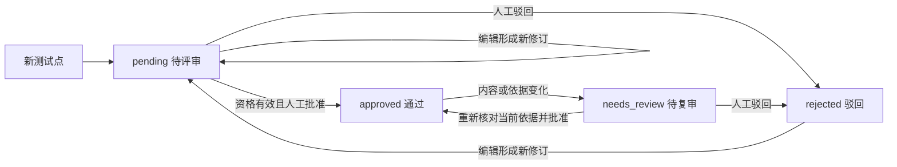

# 增量接口与任务设计（拟实现）

日期：2026-10-24。下列接口是为 CaseFlow 设计的新增／调整，不是已实现 API，也不填入第一阶段的参考站接口空表。基础前缀继续 `/api/v1/caseflow`。

## 通用契约

业务修改继续携带 `revision`（项目修订）并使用行锁；点／用例编辑另带预期实体修订与依赖指纹。任务组另带 `request_id` UUID，记录输入摘要；同 request_id 同输入返回原组，不同输入返回 409。读取不写业务状态，不以 GET 偷建证据或补迁数据。

沿用 400 业务校验、404 不属于当前项目／不存在、409 过期／幂等冲突和 422 结构校验。新批量校验错误的 detail 使用 `{message,items:[{id,reason}]}`，前端 api 包装扩展兼容 string/object，旧接口字符串响应仍接受。错误不回传密钥或私有调用体。

每个新读写路径按 pid 校验 document、evidence、bundle、point、case 和 group 的归属；不把通用 `/api/v1/kb/documents` 全局列表作为项目资料列表。归档项目允许只读；新写请求对归档项目返回 409，旧资产保留。

## 第三阶段接口

| 方法／路径 | 输入与行为 | 输出／兼容 |
|---|---|---|
| 现有 `POST /projects/{pid}/files` | 保留 multipart 的 revision/role/previous_id/file；新增可选 source_url。校验、解析、生成新 ID后在同一事务保存侧表和 JSON 文档 | 仍返回 public project；原件及快照不随列表重复传输；原有限制保留 |
| 现有 `POST /projects/{pid}/texts` | 保留原输入，新增可选 source_url；粘贴内容作为 text 来源的原始 UTF-8 bytes 保存，清理后形成快照 | 新文档 source_kind=paste，不从 name 扩展名推断格式 |
| `GET /projects/{pid}/documents` | 当前与历史资料元数据；不访问全局知识库列表 | 返回版本链、format、role、source_url、original_available、parser_signature、snapshot_sha256、warnings、parse_status、index_status |
| `GET /projects/{pid}/documents/{did}` | 读取固定版本的规范快照、unit 目录和处理信息 | 不做重新解析／重建；旧资料显示 legacy_text 和原件缺失 |
| `GET /projects/{pid}/documents/{did}/original` | 仅返回实际保存的原件；不存在返回404 | PDF 用 application/pdf，允许同源 inline；其他格式下载，带 nosniff、确定文件名；不伪造旧原件 |
| `POST /projects/{pid}/evidence` | `{document_id,snapshot_sha256,segments,quote}`；校验冻结快照和精确区间，确定性创建／复用 evidence_id。无模型调用 | 返回 id、location_label、location_status、viewer_url；仅追加证据表，不改变 R/T 正文或伪造审核 |
| `GET /projects/{pid}/evidence/{eid}` | 重新校验版本、位置与文字；支持历史版本 | 返回文档元数据、逐片段文本／区间、viewer_url；invalid 明确报错，不显示有效高亮 |
| `POST /projects/{pid}/evidence/resolve-legacy` | `{document_id,page,quote}`；兼容旧坐标，仅查找，不入库 | 返回零／唯一／多个候选区间；唯一仍由前端调用 evidence 创建取得稳定链接，多候选必须明确选择 |

位置字段详见[数据设计](03_数据与版本设计.md)。viewer_url 由服务端固定模板生成：`/#/projects/{pid}/documents/{did}?evidence={eid}`。导出链接用确定的本机基础地址 `http://127.0.0.1:18180` 拼接相对模板，不能信任模型 URL 或未经验证的 Host 头。source_url 仅接受 http/https 作为元数据链接，前端不执行其他 scheme，服务端不自动访问它。

CaseFlow 的 RAG 投影新增内部 `ingest_snapshot` 入口：接收冻结、已清理的 pages 和分块元数据，复用 kb_documents/kb_chunks、向量缓存和搜索服务。逐页切分且保留 `kb_chunk_id → document_id/unit/start/end` 映射，不重新解析拼接 TXT 后靠文字猜页。该内部投影记录为检索文本，其 original_bytes 即使保留 UTF-8 派生数据也绝不公开为用户原件；原件只走 CaseFlow 版本接口。

索引标识由授权版本+快照哈希+切分／模型／排序签名确定；只复用完全匹配的 ready 索引，成员必须与允许版本一致。不使用全局 active、不自动启用 legacy knowledge worker；现有 `index` 任务继续在 CaseFlow worker 内处理。上传成功不自动触发 Embedding。索引失败／过期与原件／解析成功分开显示。

## 第四、五阶段接口

| 方法／路径 | 最小输入／行为 | 返回／约束 |
|---|---|---|
| 扩展 `POST /projects` | 现有 name，新增可选 workflow_mode；第4段起新建默认 standard | 旧项目缺字段只读按 strict；不批量切换 |
| `POST /projects/{pid}/workflow` | revision、mode=standard/strict | 项目修订+审计；不改 R/TP 审核；未完任务因模式变化过期 |
| `POST /projects/{pid}/task-groups` | revision、request_id、consent=true；按 kind 接受下面的输入 | 202 返回组 ID、冻结输入、叶批次清单／估算；不增加模型预算 |
| `GET /projects/{pid}/task-groups` | 项目内列表，支持 request_id 精确找回；默认最近50组 | 状态、完成／失败／待处理数、可继续原因；不靠只取前50项遗漏 pending 请求 |
| `GET /projects/{pid}/task-groups/{gid}` | 查看组与 item、叶任务及保存的结果 IDs | 数据库为最终事实；部分结果和失败记录可查看 |
| `POST /projects/{pid}/task-groups/{gid}/resume` | revision、同一组；只对尚可继续项 | 未知外部结果或依赖失效返回409，不自动另建付费请求 |
| `GET /projects/{pid}/basis-bundles/{bid}` | 包内容、coverage、依赖 current 状态 | ready/partial/stale；历史包仍可查看，不悄悄重算为新版本 |
| `GET /projects/{pid}/test-points` | bundle_id、搜索、group/type/module/priority/status、needs_attention 筛选 | 当前点、三类状态、依赖 current、复审原因；默认不隐藏需关注内容 |
| `POST /projects/{pid}/test-points` | revision、intent、分组/类型/模块/标签/优先级、bundle_id、规则/包项/证据 IDs、questions | 人工补充 pending 点，code 稳定；不自动批准 |
| `POST /projects/{pid}/test-points/{tid}` | revision、point_revision、dependency_fingerprint、可编辑内容与新依据选择 | 内容变更新修订并失效旧批准；新包绑定显式填写，不能隐式沿用新原文 |
| `POST /projects/{pid}/test-point-reviews` | revision、items[{id,point_revision,dependency_fingerprint}]、decision、note、逐项人工解决记录（需要时） | 明确集合、整批校验／整批保存；批准条件见数据设计；驳回也有审核记录 |
| 扩展现有 `POST /projects/{pid}/clarifications` 及 `/{cid}` | 保留旧规则关联与 answer；新增可选 point_ids、basis_bundle_id/basis_item_ids、原问题引用。规则关联可为空，但必须至少有一个有效规则／包项／点关联 | question_id使用澄清ID；问题与回答进入原审计，按依赖使相关内容待复审。用户可明确回答／说明某个风险不适用，不能用统一批量勾选消掉所有问题 |
| 扩展既有 case 编辑／review／proposal／export | 新链路携带 point_revision、binding_fingerprint；旧输入仍按 strict/legacy 处理 | 新旧分支共用受控验证器；导出增加点与版本定位；不伪造旧点关系 |

任务组 kind 与条件字段：

| kind | 输入 | 产物 |
|---|---|---|
| `prepare_basis` | target（1—1000字）、document_ids（1—100，含明确选择的历史版本）、可选目标 rule_ids（最多100，未指定时从范围内形成候选） | 完成时产生不可变 basis bundle；必要的规则补齐／变更候选按下述规则保存 |
| `extract_points` | basis_bundle_id；可选目标 rule_ids（最多100） | 分批 TP 草稿与位置检查／模型意见，不批准 |
| `expand_cases` | point_bindings（1—100个 `{id,revision,fingerprint}`） | 每点一个叶批次、每批最多3条详细用例草稿；同点多次生成需新组并展示已有内容 |

不新增“自动批准所有测试点”模式，不在新 standard 项目开放旧直接 R→用例绕过路径。任务组提交的资料范围取自冻结包且再次显示授权，不让客户端随意扩大。叶任务若涉及的单点目标规则超过8条或上下文超过预算，要求先拆点／缩小范围，不能默默漏掉依赖。

## 明确执行依据准备

`prepare_basis` 由程序排定步骤，不依赖模型愿不愿意调用检索工具：

1. **冻结范围**：核对目标、用途、文档版本和模型配置／处理签名，记录所有 unit、段落目录及解析提醒；任务组保存 project revision。列出全部选中资料，不把没读到的资料藏起来。
2. **全文处理清单**：复用已有完全匹配的文档/处理签名/完整提取记录；只有一条手工 R 或前端 unread 标记不能作为完成证据。未证明完成的版本按既有 `extraction_segments` 的预算与不重叠策略遍历全文，单段结构化结果校验及已知用量最多修正一次；上下文资料也逐段记录目标相关公共条件／必要上下文，不能只读需求用途。
3. **保护已有规则**：新增内部 `merge_preparation_candidates`，只用于新准备流程。已有 R 的文字、回答、排除和人工确认一律不覆盖；同版本、同文字和同精确依据的候选精确去重，其余追加 draft。更新文档沿用人工变更候选，不直接替换旧 R；已存在的同一候选只复用。旧 `apply_extraction` 的严格流程语义保留。
4. **显式检索与回读**：构造确定查询队列（目标及每条选中目标规则，单条查询最多500字），在本次版本集合的索引运行当前检索策略；逐条保存检索、无命中、被截断／未完成情况。对拟采用的每个命中回读冻结 unit，校验并生成 evidence_id；不能直接把跨页拼接命中当连续引文。目标过长时原文保留，检索查询取前500字并在日志标注；全文处理不因此截断。
5. **形成包**：目标规则、适用公共条件、必要上下文及问题分别列出，保存采用/未采用的原因与引用。所有 segment／query 完成才 ready；否则 partial。相关未决变更不自动映射成新规则，记为阻塞问题；其他独立规则仍可用于点草稿。

准备过程中分段／检索响应先保存在任务结果，最终提交才合并规则和保存准备包，避免半段规则伪装完整分析。失败时已有人工资产不动。缩小范围或确认变更后重新准备可复用相同冻结版本和签名的已完成 segment 响应；上下文、模型或协议变了不得按旧响应续跑。

跨组复用还必须比较完整输入摘要：阶段、project_id、目标、授权版本集合、快照哈希、模型配置ID、提示/解析/打包签名、实际模型消息或检索query/index manifest；包含回答的阶段也纳入对应回答内容。只同文档、同模型或同签名不够，不复用不同目标／范围的语义结果，不跨项目复用私有响应。复用的是已确定完成的同输入响应，未知调用不进入此缓存。

包内公共条件选择的适用性需点审核确认；模型声称找全不能替代覆盖清单。严禁因某次检索未命中就删除既有 R 或判定全文没有该要求。

## 测试点提取与详细用例生成

- `extract_points` 使用程序提供的规则及包内依据；按最多8条目标规则、完整序列化请求不超过32768字节分组，必要时继续拆分。每次最多3个点、最多一次已知响应修正，并可增加一次同模型独立语义复核；合计最多3次生成调用／叶任务，Embedding／重排另外逐次登记，仍受日限。返回 intent、group、types、module、priority、rule_ids、basis_item_ids、evidence_ids、questions，不返回自由 URL 或批准状态。
- 校验必须覆盖点的目标规则和证据集合；未解决问题保存在草稿，位置无法验证的产物不能获得有效引用标签。独立语义意见与人工评审分开；复核失败可保存结构与位置均合格的 pending 点并明确 unavailable。
- `expand_cases` 每个叶任务只处理一个已通过且 current 的点；沿用有界 LangGraph 及现有每批最多3条、每条最多3步、最多5次设计／8次工具／1次复核的上限。服务端强制先注入点及适用依据，并继续检查已有用例；模型是否再搜索不决定基础依据是否已准备。
- 统一新增 `build_basis_context` 给生成和复核使用同一目标规则、该点适用公共条件、用户回答、证据、文档版本和数值记录。新复核协议以 source_id 回指包中允许项，逐用例检查自己的允许集合，不再限定只能引用直接 requirement_ids。
- 新生成期间额外检索发现的内容不能悄悄扩大已批准点的依据集合；可保存为待确认线索，用户重新准备／绑定并复审后才能采用。完整的单点依据即使拆分后仍超上下文预算，应明确阻断并要求拆点，不静默截掉公共条件。
- 旧 `review_cases` 的“已确认规则+source_indexes”协议为 legacy 保留；新版本协议明确标记 draft 规则来源，不称为人工已确认。保存 v2 指纹同时含 TP 修订、包、公共条件、原文版本和规则绑定；四字段检查与人工用例审核逻辑继续保留。
- 新 standard 路径在任务创建、模型输入、格式校验、add_cases、grounding、edit_case 和 accept_proposal 共用同一个资格函数。旧 strict 路径继续要求 confirmed；numeric rule 的确认、来源数值、适用性校验两种模式都不放松。

## 多批次可靠处理

任务组和叶任务分开：组保存在 cf_task_groups；真实叶工作仍使用 cf_tasks/cf_events、CaseFlow worker、Runtime 租约、cf_requests 和 durable_operations，不启用旧工作器。

- 叶任务新增 kind 为 `prepare_segment`、`prepare_retrieve`、`prepare_finalize`、`extract_points`、`expand_points`。用户不能直接用叶接口伪造组绑定；组调度器生成它们的 request_id＝UUID5(group_id, item_key)，item_key 含输入版本/点修订/协议摘要。
- 每项目只允许一个活跃旧任务或新任务组。scheduler 顺序安排叶任务，其他项目可按现有 worker 能力排队。每叶沿用600秒时限和最多两次自动租约接管，不把长组强行塞入一个600秒任务。
- 创建组时 expected_project_revision 为当前修订；每个叶开始与提交均检查组、输入依赖、模型配置和处理签名。该组自身保存点／用例后，在同一事务推进 expected_project_revision；其他途径改变项目修订则组 stale，停止新调用和业务写入。不能把每个新修订无条件视为“自己的变更”。
- 准备过程的中间响应／manifest只写任务组／任务，不改变业务修订；最终 prepare 合并规则与包时才递增。提取点和展开用例则逐叶原子追加，已完成内容即时可查，后续失败不丢弃先前批次。
- 每叶成功提交必须在同一个受租约保护的事务写业务内容、结果 ID/提交标记、组 item 完成、cf_tasks completed/result、finished 事件及组下一修订。新叶路径使用统一提交辅助函数，不沿用“先写业务再另事务 rt.finish”的间隙。崩溃后先看提交标记，不重放已保存结果。
- 模型／Embedding／重排调用先登记 issued；保存响应后才能继续。已完成响应可复用，issued 且结果未知的 paid operation 阻止自动重发和创建替代请求；组整体 blocked，后续批次不自动继续。金额预算仍没有保证，页面沿用现有日请求预算和额度核验。
- 已知格式失败／输出截断只标该 item failed，可继续其他独立待处理 item；预算不足或结果未知立即停止派发。全部 item 尝试后有成功有失败时组 partial；首次失败与修复尝试分开保留，不改写成从未失败。
- 显式 resume 只接续尚未完成且安全的 items，完成项不再生成；依赖或设置变化则新建经用户确认的新组，旧结果保留。修改建议始终绑定原 T 修订，不通过续做覆盖后来的人工编辑。

任务组状态为 queued/running/completed/partial/blocked/failed/stale，点状态见下图。前端 SSE 仍跟随当前叶任务，组列表轮询给出整体进度；无需新 WebSocket。先从 URL/本地 pending request_id 查询原组，未知提交不得生成新的 request_id 重发。组 request_id 精确查询必须不受最近50条分页限制。

## 点状态图（拟实现）

源文件：[点状态.mmd](点状态.mmd)。needs_attention 是计算出的筛选标记，不是第五种审核状态；位置、语义报告、人工批准不混用。

## 导出与变更的增量约束

Excel/Markdown 增加 TP 编号／修订、准备包 ID、规则修订、公共条件摘要、来源版本、位置说明和程序链接；旧用例写“历史直接关联”，对应点列为空。不把规范段落称为 PDF 页。Excel 继续用 literal inlineStr 防公式执行，链接列先写可复制文本，不新增用户可注入公式。

用例建议保留 `replaces_case_id/revision`，另绑定原点与包指纹，应用时同时校验；更新来源后必须先复审相关点，再按当前点提出用例建议。复审没有正文变化也递增用例修订。历史执行快照和旧链接保留；生成／批准不会新增“业务执行通过”。
