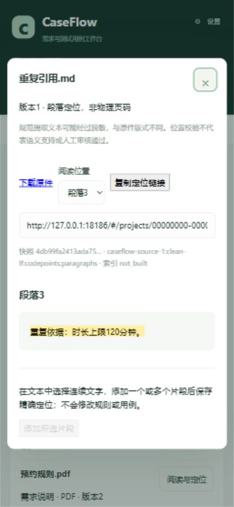

# 第三阶段实际验证记录

日期：2026-10-24（Asia/Shanghai）；代码基线cbe7717。本轮无真实模型请求、模型设置变更、飞书更新或用户库迁移。历史275/284项回归数不算本轮结果。

## 实际检查

| 检查 | 实际结果及范围 |
|---|---|
| 定向后端 | 初始54、加入新用例78、合同/部署扩展86项通过；最终离线扩展189项通过，以最终命令为准，不相加 |
| 扩大回归首轮 | 195通过、4失败；4项旧diagnostic_core依赖数据库读取脱敏配置，抛出ModelBlocked，未改旧测试以掩盖失败 |
| 前端逻辑 | pnpm test：24通过，含4项新增路由、重复/Unicode高亮与多段分隔测试 |
| 类型/生产构建 | vue-tsc --noEmit、vite build通过，31模块；生成OpenAPI及前端类型同步 |
| 数据库新增测试 | 已收集10项；首项fixture连接数据库时error并maxfail停止，未进入schema创建/业务断言，不记为通过 |
| 原件/迁移/恢复 | 用户库不可连接，未初始化新表、未对用户库运行迁移或备份停启脚本，SQL触发器/原子性/恢复待验 |
| 页面 | 实际生产构建配合公开合成内存夹具；观察结果见下表，不等同真实API/SQL端到端 |

最终189项命令（仓库根目录、PowerShell）：

```powershell
$env:PYTHONPATH='src'
$env:PYTHONUTF8='1'
./.venv/Scripts/python.exe -m pytest tests/test_caseflow_sources.py tests/test_caseflow_core.py tests/test_caseflow_grounding.py tests/test_rag_core.py tests/test_rag_provider.py tests/test_contracts.py tests/test_deployment.py tests/test_api_security.py tests/test_investigation_core.py tests/test_investigation_provider.py tests/test_recovery_core.py tests/test_verification_core.py tests/test_evaluation_core.py tests/test_collaboration_core.py tests/test_demo.py tests/test_demo_review.py tests/test_external.py tests/test_product_value_runner.py -q -p no:cacheprovider --basetemp=.runtime/stage3-offline-final
```

其中Provider测试使用受控transport/响应，未向外部模型发送请求。首次扩大检查还包含`tests/test_diagnostic_core.py`：失败项为test_reference_and_runtime_fact_validation、test_attachment_uuid_citation_resolves_only_unique_selected_exact_quote、test_missing_or_unsupported_context_has_specific_nonempty_missing_items、test_real_pilot_regressions_preserve_urls_and_mark_restart_risk。它们调用dynamic_secrets读取diagnostic_configs时失败；最终离线命令明确排除该整个文件，不把排除记为修复。

新增数据库执行使用进程内conninfo增加connect_timeout=2（未改.env），`pytest tests/test_caseflow_sources_database.py -q --maxfail=1 --tb=no -p no:cacheprovider`在第一项连接失败。真实PostgreSQL、RAG与空库启动回归未完成；未运行依赖旧实验实例的test_integration.py。

前端/合同命令：仓库根运行`./.venv/Scripts/python.exe scripts/export_openapi.py`，进入frontend运行`pnpm run types`、`pnpm test`、`pnpm run build`。生成脚本不启动应用lifespan或模型。前端初次构建曾因新增Segment与旧诊断Segment同名导致类型冲突，改为SourceSegment，重新导出/生成/构建后通过。旧.pytest_cache权限导致过一次cache警告，后续使用禁缓存和独立basetemp；未删除原缓存。

## 页面观察：受控夹具

使用[scripts/validation/caseflow_sources_preview.py](../../../scripts/validation/caseflow_sources_preview.py)，监听127.0.0.1:18186，合成数据全部在内存中；没有数据库、worker或模型。它使用实际解析/快照/位置纯函数，但路由和持久化为夹具实现。证据ID仅在本次内存进程内有效，重启会重建项目资料；截图中的链接不是交付给用户长期使用的业务链接。

| 操作 | 可确认结果 | 不能据此确认 |
|---|---|---|
| 打开知识列表并勾历史版本 | 当前/历史版本、原件缺失、格式/索引状态显示 | 真实数据库状态刷新 |
| 点击重复引用 | 显示2个候选，未自动选择；选择第二处后高亮段落3 | SQL证据写入、真实请求账本 |
| 刷新同一hash URL | 回到同一项目/版本/证据，mark位于u3，文字逐字一致 | 进程重启后持久化 |
| 点击复制定位链接 | 页面提示已复制、只读链接框包含当前项目/版本/证据 | 浏览器剪贴板读取接口为空，跨应用粘贴未核验 |
| 打开历史PDF | 显示版本1、存在更新版本、真实第1页和180分钟规范原文 | iframe已进入原件URL，但内置浏览器未渲染PDF内容；需常规浏览器复测 |
| 打开无原件历史资料 | 历史文本段、原文件未保存，正文仍可读，无伪造PDF页码 | 真实历史库迁移 |
| 更换为另一项目访问同一文档/证据 | 显示“记录不属于当前项目”，无另一项目原文 | SQL外键及真实接口隔离 |
| 390×844视口 | 正文/高亮/关闭按钮可见；DOM测量body宽390，无整体横向溢出 | 所有浏览器、输入方式和PDF插件表现 |



初次定位滚动把阅读框标题部分卷出可视区，改为只滚动文本区域并在面板打开期间锁定背景滚动，重建后窄屏复测。随后在受控页面实际拖选第一段与第三段，逐次添加并保存两个片段；刷新后两个mark分别保留，第二段未显示。该观察仍只证明内存夹具中的页面行为，不证明真实数据库持久化。

第二张证据：[受控多段保存刷新](screenshots/02-controlled-multiple-segments-390.png)。首轮按可访问名称寻找下拉框未匹配；读取当前页面后改用已确认的select元素，完成切换，未改业务数据。

复现夹具：先在frontend构建，再在仓库根运行`./.venv/Scripts/python.exe scripts/validation/caseflow_sources_preview.py`，访问`http://127.0.0.1:18186/#/projects/00000000-0000-0000-0000-000000000001/knowledge`。这是测试入口，禁止替代正式API部署。

## S3验收逐项归档

“部分”表示存在工程证据，但尚缺矩阵要求的其他证据，不能宣布该项全部通过。

| ID | 当前证据 | 状态/待验 |
|---|---|---|
| S3-01 四格式与粘贴 | 解析/快照纯函数、受控MD/DOCX/PDF页面；真实上传bytes/hash测试已编写 | 部分；真实API保存/读取/下载及PDF渲染待验 |
| S3-02 legacy | 旧格式不推定PDF、页面缺原件提示与正文 | 部分；真实GET无写入/迁移后旧JSON不变待验 |
| S3-03 精确引文 | bool/越界/重复/倒序/哈希/文字校验逻辑、请求类型 | 部分；SQL证据持久化与接口篡改拒绝待验 |
| S3-04 重复文字 | 两候选、选第二处、刷新回u3；链接框正确 | 部分；跨应用粘贴及真实持久化待验 |
| S3-05 多段/跨页 | PDF空白页及跨页片段纯逻辑；受控页面实际拖选u1/u3、保存并刷新后分别高亮 | 部分；真实API及跨PDF页选区待验 |
| S3-06 Unicode/清理 | emoji、组合字符、CRLF、脱敏后偏移及前端code point高亮 | 离线逻辑通过；真实导入往返待验 |
| S3-07 路由 | 直接hash、刷新、关闭、错误UUID解析、窄屏 | 部分；完整前进/后退、归档、原件插件与真实数据库联调待验 |
| S3-08 隔离 | 受控页面错误项目拒绝；真实scope测试已编写 | 部分；真实接口404/授权检索范围待验 |
| S3-09 更新 | 原件身份不同不复用；冻结快照不重解析测试；受控历史180/新版120 | 部分；真实旧证据跨更新持久化待验 |
| S3-10 边界/失败 | 既有解析边界回归、纯函数错误；新增事务失败测试 | 部分；真实并发和侧表故障回滚待验 |
| S3-11 索引 | 参数变化标stale、按页切块/位置比对源码与已有RAG回归 | 部分；真实索引复用/失败状态/关键词零请求待验 |
| S3-12 迁移/恢复 | 显式dry-run/幂等侧表测试及恢复步骤已提供 | 受阻；真实执行和含bytea独立恢复未完成 |

## 环境阻塞与处理边界

本机127.0.0.1:18283不可连接，psycopg连接超时。Docker Desktop未提供可用Linux engine pipe，日志显示`sailor-ingest.sock`重命名为stale时“文件无法被系统访问”。尝试隐藏启动及官方普通restart命令后仍未恢复；未重置Docker、删除socket/容器/数据卷，未修改系统虚拟化设置。参考[Docker Desktop restart官方说明](https://docs.docker.com/reference/cli/docker/desktop/restart/)，不能把启动命令发出写成恢复成功。

交付前静态检查：本阶段4份Markdown的21个本地链接及表格列数通过；前两阶段15份产物加原manual-validation文件共16份SHA256与开始时一致；`git diff --check`通过。最终离线189项复查仍通过。临时页面进程和标签页已关闭，视口恢复默认。一次通过系统进程清单查找测试进程的清理尝试被访问权限拒绝，随后通过本轮exec会话的Ctrl+C停止自建夹具，没有终止用户进程。

后续真实验证按[迁移与恢复操作](03_迁移与恢复操作.md)执行。除环境修复外，PDF原件渲染、真实复制粘贴、真实服务的手工跨单元选区及完整浏览器导航仍需明确补验。本轮没有模型质量或效率改善结论。
