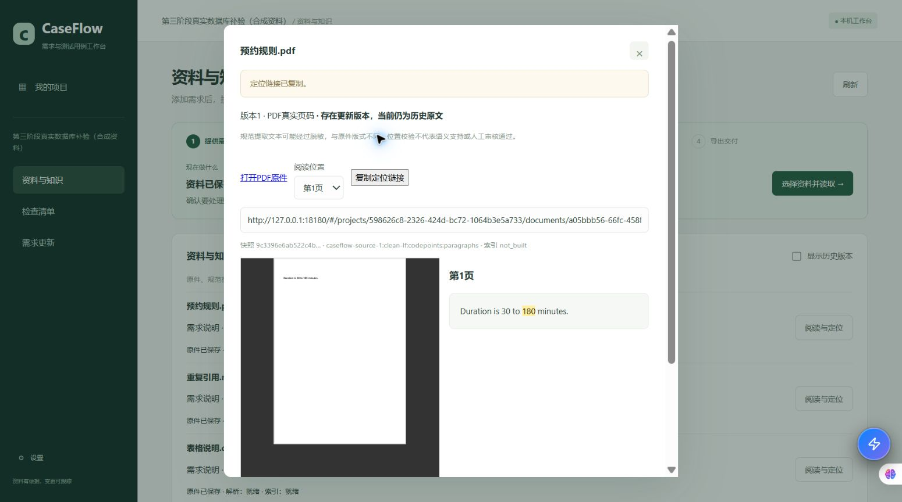
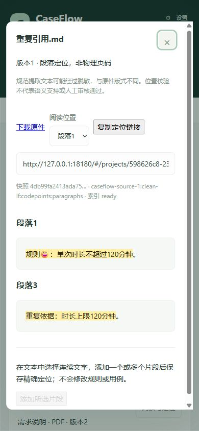

# 第三阶段：Docker恢复后的数据库与页面补验

日期：2026-10-24（Asia/Shanghai）。实现基线`aef09c1`，分支`feat/caseflow-staged-upgrade`。用户明确告知Docker恢复后继续本阶段验证。**隔离数据库、迁移和备份恢复已完成；未部署迁移用户库，未进入第四阶段。** 本文追加实际结果，不改写[首次受阻记录](02_验证记录.md)。

## 环境和数据边界

Docker Server 29.7.2可用。开始时仅有kb_frontend、kb_backend、kb_postgres，未对它们执行写入、停止、重启或配置修改。使用本地已有`pgvector/pgvector:pg16`镜像，`--pull never`创建独立容器`caseflow-stage3-verify-20261024`，ID为`efffdabc4e4538bd7c480060579e7189538fdb367ad9aefe04e03ad3f9cbd806`，标签`io.caseflow.task=stage3-verification-20261024`。只绑定127.0.0.1:18383，数据目录使用tmpfs，没有挂载用户目录或已有数据卷。

所有DSN覆盖只在当前测试进程，未编辑.env或用户模型配置。新测试库创建默认禁用配置，旧回归里的模型设置和受控响应只在测试schema中。清空进程内真实模型密钥，并在完整回归中拒绝非loopback socket连接；未联网尝试任何真实模型服务。创建测试数据及真实API页面服务不启动后台worker，模型方法显式拒绝调用。独立测试库与恢复库均只含合成资料。

## 工程结果与首次失败

| 检查 | 实际结果 |
|---|---|
| 初次数据库定向 | 59通过、1失败，范围为sources/caseflow/rag/durability/product_bootstrap |
| 修正及新增后sources数据库 | 12项全部通过，耗时6.28秒 |
| 完整后端回归 | 322通过，耗时123.69秒；仅排除依赖旧实验实例的test_integration.py；1条anyio已导入的pytest断言重写警告 |
| 非本机网络连接 | 完整回归拦截计数0次；受控Provider不是模型质量证据 |
| 前端 | pnpm test：24通过；vue-tsc与vite build通过，31模块 |

首轮失败出在新增legacy迁移测试：`store.update`返回数据库原始state，而GET API会附加只读summary。原测试混比这两种表示，差异仅为summary。已改为迁移前后完整API响应相等，并另外从数据库核对原state和revision均不变；没有删除字段规避断言，也没有改变业务实现。

另外增加2项真实SQL用例：侧表已经INSERT后故意抛错，确认整个事务回滚，项目、原件和audit均无半成品；关键词检索不触发Provider、只返回允许项目/文档，列表及详情反映真实索引ready/failed状态。其余10项覆盖四格式原件字节/摘要、冻结快照、重复消歧、旧链接跨新版本、归档只读、项目隔离、篡改拒绝、legacy GET无写入、迁移幂等、跨段证据、SQL不可变约束、解析/修订失败。

复测命令在仓库根运行，测试DSN仅指向上述新容器：

```powershell
$env:PLATFORM_DATABASE_URL='<本轮独立测试库DSN，127.0.0.1:18383/caseflow_stage3>'
$env:PYTHONPATH='src'
$env:PYTHONUTF8='1'
./.venv/Scripts/python.exe -m pytest tests/test_caseflow_sources_database.py -q -p no:cacheprovider --basetemp=.runtime/stage3-db-r2-20261024
./.venv/Scripts/python.exe -m pytest tests --ignore=tests/test_integration.py -q -p no:cacheprovider --basetemp=.runtime/stage3-full-recheck-20261024
```

完整回归由`.runtime/stage3-recheck-20261024/run_full.py`包装执行：先在新库初始化默认diagnostic配置供旧核心用例读取，再注入本机网络限制，输出JUnit至同目录`full-results.xml`。这是受控测试初始化，不修改用户库。复测时以独立DSN替换占位符，不将用户模型密钥带入测试。

## 真实API与SQL页面结果

页面使用实际opslens.api路由及生产前端构建，127.0.0.1:18180；只有lifespan替换为不启动worker的测试入口，未模拟documents/evidence响应。合成数据包括180→120分钟PDF版本、带emoji与重复规则的MD、DOCX表格、TXT、粘贴文本及缺原件legacy资料。原件API已逐字节核对；资料列表显示真实索引就绪状态。

| 操作 | 观察结果 |
|---|---|
| 点击旧page/quote引用 | 返回2个候选，无自动选择；选第二处后SQL证据ID幂等 |
| 刷新/新标签打开 | 同一版本、同一u3引文恢复，高亮逐字一致 |
| 真实手工选区 | 鼠标拖选u1与u3，分两次添加，保存后刷新仍有2个mark，u2不被混入 |
| 390×844阅读 | DOM测量viewport=390、body宽390，无整体横向溢出 |
| 历史PDF | Edge内嵌显示真实原件第1页；旁边规范文本高亮180，明确标记已有新版，不被120替换 |
| 链接复制粘贴 | 自动复制按钮显示成功，但虚拟剪贴板不接收Clipboard API写入；读取链接框Ctrl+C后核对剪贴板一致，Ctrl+V到未提交文本框也一致，随后清空，没有保存为资料 |
| 浏览器导航 | 发现并修复同文档去掉evidence后残留旧高亮；后退到普通文档时mark=0，前进恢复u3；旧引用候选流程复测仍有效 |

修复位置为CaseFlow.vue的applyRoute：比较路由和当前source的evidenceId是否不同，处理“同文档，有证据→无证据”转换，同时保留未选定的旧quote消歧。业务数据库、模型配置和生成协议均未因本修复改动。





浏览器自动化的虚拟剪贴板与页面Clipboard API写入不同步，不能把按钮提示写成跨应用自动粘贴通过；只读链接框的复制路径已实际通过。内置浏览器的PDF插件能力仍有限，本轮PDF渲染通过范围是Edge。未检查所有浏览器或扫描件OCR。

## 迁移与独立恢复

在新测试库中用legacy资料验证dry-run→apply→再次apply，待补数量为1→1→0；读取与dry-run不写版本行，apply只追加legacy侧表。迁移前后数据库原始业务JSON、project revision及完整API响应不变，没有重新导入或模型提取。

页面服务停止后，使用现有`archive_product.fingerprints`对该测试库全部41张public表取数量及内容SHA256，使用容器内pg_dump自定义格式备份，再用createdb及pg_restore恢复到全新`caseflow_stage3_restore_20261024_083302`。没有调用会停启用户服务的Backup.ps1；复用的是同一pg_dump/pg_restore与指纹比较机制，不能称为生产停启脚本已验。

实际工具操作：

```text
docker exec caseflow-stage3-verify-20261024 pg_dump -U opslens -d caseflow_stage3 -Fc --no-owner --no-privileges
docker exec caseflow-stage3-verify-20261024 createdb -U opslens caseflow_stage3_restore_20261024_083302
docker exec -i caseflow-stage3-verify-20261024 pg_restore -U opslens -d caseflow_stage3_restore_20261024_083302 --exit-on-error --no-owner --no-privileges
```

由私有验证脚本以二进制文件重定向输出/输入；执行前核对容器完整ID、标签及tmpfs属性，拒绝混用已有容器。恢复后41/41表指纹完全相同：7份文档版本（6份含原件，1份legacy）、3条证据；每份原件bytea与SHA256一致，每份快照摘要一致，全部证据API完整响应与恢复前一致。恢复后的UPDATE/DELETE触发器拒绝修改，错误项目/版本外键INSERT被拒绝，再次比对指纹无改变。cf_requests、kb_model_calls、diagnostic_requests均为0行。

备份89234字节，SHA256为`c703433ee8bc8644660cd654bdbfc37bf56739892516c3224401d58d08e4fa92`。逐表指纹与机器可读结论见[恢复校验摘要](05_恢复校验摘要.json)。私有合成dump、运行脚本和JUnit位于`.runtime/stage3-recheck-20261024/`，未提交Git。该dump只用于本轮合成环境，不能作为用户业务库的备份。

准备页面数据时曾与测试schema并发初始化，遇到vector扩展暂处另一schema而初始化失败；事务回滚，等待完整回归结束后串行初始化成功。临时种子脚本也曾把创建项目201误判为200；修正夹具成功码后继续。这两次是验证工具问题，未修改业务API或把失败写成通过。

结束时关闭本轮3个测试标签，恢复临时视口，停止自建API进程；核对完整ID/标签后仅停止自建临时数据库容器，未删除任何已有容器或数据卷。Docker运行列表仍是开始时的3个知识库容器。tmpfs测试库数据随测试容器停止释放，合成dump保留在上述私有运行目录；需要复现时恢复至新的独立测试实例，不依赖本轮临时链接持续在线。

## S3验收更新与剩余范围

| 项 | 更新证据 |
|---|---|
| S3-01/02 | 四格式与粘贴真实API原件/快照往返、legacy不写与迁移；实际列表/阅读/PDF页面 |
| S3-03/04 | SQL证据幂等/篡改拒绝/项目绑定，重复位置人工选择、刷新和新标签；手动复制粘贴 |
| S3-05/06 | 跨页/多段与Unicode工程回归，真实手工u1/u3保存刷新；跨PDF页选区未单独做页面操作 |
| S3-07 | 实际hash前进/后退/刷新和本轮修复，归档读写规则数据库回归 |
| S3-08/09 | 真实项目/原件/证据404和授权检索；新版本后旧链接保持、解析规则不重写冻结快照 |
| S3-10/11 | 解析/修订/写入错误事务回滚；真实逐页索引、复用、failed状态与关键词零模型 |
| S3-12 | 真实dry-run/幂等迁移，含bytea合成备份独立恢复、41表指纹及约束通过 |

第三阶段主要工程验收和真实页面样本已完成。仍未执行用户业务库升级/迁移/生产备份停启脚本，未验证复制按钮跨应用自动粘贴、全部浏览器和跨PDF页手工选区，也没有真实模型质量样本。按[迁移操作](03_迁移与恢复操作.md)安排实际部署，不把本轮测试库迁移说成用户库已迁移。第四阶段等待用户明确继续。
